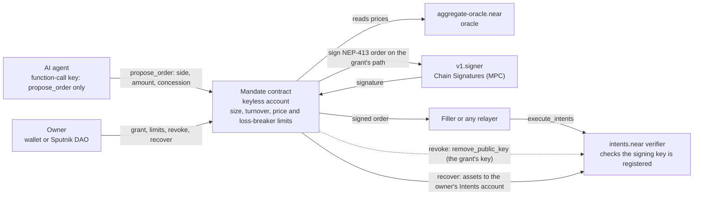

# Bounded Mandate

Give an AI agent trading authority without unrestricted control of your treasury.

A contract checks the owner's size, turnover and price limits before it signs any order. One revoke call removes the signing key; once removal is confirmed, signed orders that have not executed fail. The owner recovers the remaining assets without the agent.

**[Overview](https://gryyny.github.io/bounded-mandate/overview/)** · [Narrated pitch](https://gryyny.github.io/bounded-mandate/pitch/bounded-mandate-pitch.mp4) · [Evidence page](https://gryyny.github.io/bounded-mandate/) · [Owner console (sandbox)](https://gryyny.github.io/bounded-mandate/console/) · [Mainnet receipts](evidence/mainnet/attempt-3/dd665d1) · [Verify in three minutes](#verify-in-three-minutes)

The same files in this repository: [presentation/overview/index.html](presentation/overview/index.html), [presentation/pitch/bounded-mandate-pitch.mp4](presentation/pitch/bounded-mandate-pitch.mp4) (narration script and captions beside it), [evidence/dd665d1/page/index.html](evidence/dd665d1/page/index.html) and [evidence/dd665d1/console/index.html](evidence/dd665d1/console/index.html).

**Contents:** [mainnet run](#what-happened-on-mainnet) · [how it works](#how-it-works) · [verify](#verify-in-three-minutes) · [evidence status](#evidence-status) · [run it](#run-it) · [four paths](#four-paths) · [three checkable facts](#three-checkable-facts) · [why not just…](#why-not-just) · [criteria](#where-to-check-each-criterion) · [who needs this](#who-needs-this-and-what-is-next) · [claims and limits](#what-is-claimed-and-what-is-not) · [open challenge](#open-challenge-optional-not-run) · [mainnet runner](#mainnet-runner-opt-in) · [glossary](#glossary) · [disclosures](#disclosures). Detail: [reviewer guide](docs/reviewers.md), [comparison](docs/comparison.md), [live runner](docs/live-runner.md).

## What happened on mainnet

| Step | What happened | Transactions |
| --- | --- | --- |
| 1. Permitted trade | A 1 USDC order, proposed with the agent's function-call key, priced and checked by the contract, signed through mainnet `v1.signer` 3.18.0 (Chain Signatures), then filled: 1.00 USDC paid by the mandate, 0.322008 wNEAR received, exactly the signed amounts | propose [`4MYyWnrD…`](https://nearblocks.io/txns/4MYyWnrDyz8zh5yh7FTgvU4TYU8rDtWvy5X28vKXhz14), fill [`2PzTvXv9…`](https://nearblocks.io/txns/2PzTvXv9TLzWxV1LP6KFKP9a2mGF4gP4MLwXk1XAy1MK), settle [`AktZdWjn…`](https://nearblocks.io/txns/AktZdWjn3xSxNvx5SS7Ut44L3QMZTBA9SQraHyJUAKZf) |
| 2. Confirmed revocation | A second order (0.5 USDC) was signed and withheld. The owner's `revoke` removed the grant's key at `intents.near`, and the removal was confirmed | revoke [`H7KpB2dx…`](https://nearblocks.io/txns/H7KpB2dxPDDMJK9aYgtRd4yztqSS7nE8ZxZ1sZ5ApJSC) |
| 3. Same signed order rejected | The withheld order, relayed unchanged, was rejected by `intents.near`: "public key … doesn't exist for account mandate.bmandate.near". The rejection executed 67.25 s before the order's deadline | relay [`5R1wKwqs…`](https://nearblocks.io/txns/5R1wKwqsfxX18XqqKJ2AakKCM4bT4TTQgYQzFzhW3LLw) |
| 4. Recovery | 3.999999 USDC and 0.422008 wNEAR returned to the owner's Intents account (not the owner's NEAR wallet; withdrawing is the owner's separate later step) | recover [`Cuan44bA…`](https://nearblocks.io/txns/Cuan44bAPFyyKdrvTeXpjGSEZMsvDymuj7fVjf1K2qJt), [`7ypZiTuu…`](https://nearblocks.io/txns/7ypZiTuugefeWqfocsDsqsT81iUw8iE5eeXroYtmrEGj) |

Also on chain: the grant, which registered the MPC-derived key at `intents.near` (epoch 3, [`t6BZT5eD…`](https://nearblocks.io/txns/t6BZT5eDLAGtSJp8Xzs23SxGqmTTU4q8NSjHyYgmpgn)), and a proposal above the concession limit, which the contract refused ([`4KDPzRrd…`](https://nearblocks.io/txns/4KDPzRrdFuu1Qp6iqYnNU1RtYVR8e94e9B8nvvghLivx)). Every step is listed in the [reviewer guide](docs/reviewers.md#verify-on-mainnet-read-only).

One run, 14 November 2026: fixed proposals, not a model proposal; filled by our own filler account `filler.bmandate.near`, not third-party liquidity; 120 s order lifetime. 70.8 s of the withheld order's lifetime remained at the post-removal check and 67.25 s when the relay executed. One small run shows integration, not reliability or profitability. Two earlier attempts were filed incomplete after public-RPC problems ([evidence/mainnet](evidence/mainnet)).

Run details: attempt 3, runner revision dd665d1, approved run manifest. The 120 s lifetime and oracle age deviate from SPEC.md's 60 s (the demo uses 60 s); the owner approved the deviation with the manifest. Attempts 1 and 2 at 831c6b1: RPC rate limits, then late RPC answers, let the orders expire before the relay or the fill.

## How it works

The agent names a side, an amount and a price concession up to your maximum; a contract prices the order from the oracle, then builds and signs it for NEAR Intents inside your size and turnover limits. One owner call removes the signing key, so signed orders that have not executed fail once removal is confirmed, and recovery returns the remaining assets without the agent.



**The problem.** Pausing an agent stops new orders, but NEAR Intents orders it already signed stay valid until they expire or each one's nonce is cancelled; how cancelling works depends on the venue. Here `revoke` removes the grant's signing key at the verifier; once removal is confirmed, every outstanding order fails. The gain over waiting is at most the order lifetime: 60 s in the demo, 120 s in the mainnet run.

**What NEAR provides.**
- **Function-call keys.** The agent's key can call only `propose_order`; other methods, deposits, transfers and key changes are refused by the protocol before the contract runs.
- **Chain Signatures.** The contract gets each signature from `v1.signer` after checking the limits; no single person or server holds that key. In the sandbox evidence the signer is a single labelled test double; in the mainnet run, mainnet `v1.signer` signed the mandate's orders.
- **Verifier key registry.** `intents.near` checks the registered key on every signed intent, so revoking is a key removal.

Mechanism, step by step: [reviewer guide](docs/reviewers.md#how-it-works).

## Verify in three minutes

From a clone; no wallet, key, funds or model key:

```sh
make verify                                            # offline: committed evidence and hashes
node verify.mjs --mainnet --rpc https://near.drpc.org  # read-only: re-reads the mainnet run from the chain
make quick                                             # sandbox replay; Node 24 and network, no Rust
```

- `make verify` (Node 20+) ends `VERIFIED: evidence/dd665d1 (34 passed, 0 failed, 0 not verified, 1 skipped)`; the skipped check is the mainnet run, which it does not read from the chain.
- `node verify.mjs --mainnet` ends `VERIFIED: evidence/dd665d1 (54 passed, 0 failed, 0 not verified, 0 skipped)`, 54 read-only checks against the chain: every transaction, the trade's binding to the signed order, the key removal, the [historical replay](docs/reviewers.md#historical-replay-of-the-withheld-order) of the relayed bundle and the recovered balances. `--rpc` is needed only if the default free endpoint rate-limits.
- `make quick` prints `60/60 assertions passed`, labelled uncertified sandbox execution with test doubles.

`make verify` checks committed evidence and reruns nothing. `SHA256SUMS` is unsigned: it detects accidental or partial change, not a self-consistent rewrite, so trust rests on the commit history and on rerunning `make test`. Read-only `curl` checks: [verify on mainnet](docs/reviewers.md#verify-on-mainnet-read-only).

## Evidence status

- **Sandbox: certified at dd665d1.** 48 of 48 required cases passed ([acceptance](evidence/dd665d1/acceptance.json)). Certified means this project's own gate, all required cases passing in one run of one clean revision from a fresh clone, not an external audit ([definition](docs/reviewers.md#what-certified-means)). Signer, oracle and tokens are labelled test doubles.
- **Model output: recorded.** Genuine recorded `claude-haiku-5-5` output, replayed ([MODEL](evidence/dd665d1/tests/MODEL.recorded-proposal.json)); no gate or demo calls a model.
- **Verifier code: the mainnet code.** The pinned WASM hashes to the code at `intents.near` ([check](docs/reviewers.md#verify-on-mainnet-read-only)).
- **MPC signer response: real, recorded read-only.** A mainnet `v1.signer` response verifies in the contract's decoder ([test](contract/tests/signer_conformance.rs)); that is not our own signing, which the mainnet run exercised.
- **Mainnet: one complete run** of the scripted template, [above](#what-happened-on-mainnet) ([bundle](evidence/mainnet/attempt-3/dd665d1), [evidence page](evidence/dd665d1/page/index.html)).
- **Hosted site: GitHub Pages since 14 November 2026.** [Overview](https://gryyny.github.io/bounded-mandate/overview/), [evidence page](https://gryyny.github.io/bounded-mandate/), [console](https://gryyny.github.io/bounded-mandate/console/), [short video](https://gryyny.github.io/bounded-mandate/video/bounded-mandate-short.mp4), [narrated pitch](https://gryyny.github.io/bounded-mandate/pitch/bounded-mandate-pitch.mp4). Each served file equals its certified file in `evidence/dd665d1/SHA256SUMS` or its hash in `presentation/provenance.json`.

## Run it

From a clone; no funds or model key:

| Do | Needs | See |
| --- | --- | --- |
| `make verify` | Node 20+; offline | Last line starts `VERIFIED: evidence/dd665d1` |
| `make quick` | Node 24, network; no Rust | `60/60 assertions passed`, labelled uncertified |
| `make example` | Node 24, network; no Rust | `all three observations match the chain`, labelled uncertified |
| `make test && make demo` | Rust, `cargo-near`, Node 24 | `CERTIFIED: run …`, then `59/59 assertions passed` |

[Setup, timings, outputs](docs/reviewers.md#running-the-demo-and-the-gates); [evidence page](evidence/dd665d1/page/index.html).

## Four paths

Each is on the evidence page. The lab, alternatives view, historical proof reader and independent client are covered by the 48-case certification at dd665d1. Individual lab sessions and standalone example runs remain labelled uncertified sandbox execution. The [recorded DAO preset](evidence/dd665d1/page/index.html#dao) exposes the pinned Sputnik approval workflow.

| Path | What you do | How |
| --- | --- | --- |
| **Try** | Operate a sandbox treasury in the lab: set limits and grant, trade, attempt an unsafe trade, withhold a signed order, revoke, retry it, recover. Sandbox execution with labelled test doubles. | `make lab` |
| **Compare** | Reproduce the owner's alternatives from equal starting conditions: wait for expiry, cancel a complete or an incomplete nonce list, cancel with the signer unavailable, remove the key, re-add the same key. | `make lab`, Compare tab. Certified comparison: gate COMPARE ([report](evidence/dd665d1/tests/COMPARE.revocation-alternatives.json), [write-up](docs/comparison.md#compared-with-simpler-alternatives-compare)) |
| **Verify** | Inspect the real mainnet trade, the confirmed key removal, the rejection of the still-unexpired withheld order and the recovery, each by its transaction, with a historical replay of the withheld order; and check the committed evidence and the verifier's code hash. | `make verify` (offline), `node verify.mjs --mainnet` (reads the chain); [read-only checks](docs/reviewers.md#verify-on-mainnet-read-only) |
| **Integrate** | Run a small strategy client, separate from the demo, that uses the agent's function-call key, `propose_order` and the contract's views. An example, not an SDK. | `make example` |

`make lab` serves the lab at <http://127.0.0.1:8791/> until you stop it; it needs Node 24 and network access on the first run, and no Rust. It runs the exact deployment candidate, the pinned verifier and hash-pinned prebuilt test doubles on a local sandbox, and holds only disposable sandbox keys. Its results are sandbox execution, uncertified, and evidence of nothing on mainnet. No hosted lab exists yet. The client is [examples/strategy-client/client.js](examples/strategy-client/client.js). Details: [lab](docs/reviewers.md#sandbox-lab-make-lab), [example](docs/reviewers.md#integration-example-make-example), [historical replay](docs/reviewers.md#historical-replay-of-the-withheld-order).

## Three checkable facts

Sandbox results at dd665d1 with labelled test doubles; selected samples, not a statistical rate.

1. **No signing key.** The agent's only key is a function-call key for `propose_order`; ten agent-key attacks (other methods, deposits, `mt_transfer`, key changes) were refused by the protocol ([BOUNDARY.attacks](evidence/dd665d1/tests/BOUNDARY.attacks.json)). The order-signing key is derived by the MPC network (a test double in sandbox), and the contract requests each signature only after its checks ([`propose_order`](contract/src/lib.rs#L419)).
2. **Limits at the signature.** Of a selected sample of 15 valid scripted trades, 15 settled with no authorization refusal and every fill within the 0.5% concession ([T3.concession](evidence/dd665d1/tests/T3.concession.json)). 39 of 39 hostile requests were refused at five layers: 10 local validation, 14 contract method checks, 4 policy checks, 10 agent key permission checks, 1 verifier check ([BOUNDARY.attacks](evidence/dd665d1/tests/BOUNDARY.attacks.json), [attack log](docs/reviewers.md#attack-log)).
3. **Stop and exit.** After confirmed removal of the grant key at the verifier, a withheld signed order was rejected with the verifier's missing-key error while at least 45 s of its lifetime remained in every post-removal relay, and again after a regrant, which signs with a key on a new path ([T1.withheld-regrant](evidence/dd665d1/tests/T1.withheld-regrant.json)). `recover` returned both assets to the owner's Intents account with the agent stopped, the oracle failing and the MPC on hold ([T4.dependency-failure](evidence/dd665d1/tests/T4.dependency-failure.json)).

At the open-order limit, 32 open orders (20 signed, 12 awaiting their signature), one confirmed key removal released all 32 reservations in one callback, a withheld signed order relayed afterwards did not execute, a 33rd proposal was refused, and recovery returned every unit. The case first forces a failed removal, then retries it ([T4.open-order-limit](evidence/dd665d1/tests/T4.open-order-limit.json)).

## Why not just…

Three withheld 1 USDC orders per strategy on the pinned verifier, relayed unexpired by an unrelated account; one of them is missing from the owner's ledger. The first two rows were measured at verifier level on a plain account whose key is a labelled test key standing in for the MPC-derived key (COMPARE); the third compares the two contracts (T5, T1) ([COMPARE](evidence/dd665d1/tests/COMPARE.revocation-alternatives.json), [T5](evidence/dd665d1/tests/T5.baseline.json)).

| Instead of key removal | Measured result | Remove the key, resume with a fresh key (the mechanism the mandate uses) |
| --- | --- | --- |
| Wait for expiry | 3 of 3 withheld orders executed; protection starts at each order's deadline | 0 of 3 executed after confirmed removal |
| Cancel nonces (an empty intent signed per order) | Needs the account's signer for each one. With the ledger's two nonces, 1 of 3 still executed; with a complete list, 0 of 3 | No list and no signature by the grant's key; the owner signs `revoke` |
| Pause the agent | In our re-implementation of the Claw Guard design (not their deployed product), a withheld order executed after pause and agent removal; a regrant revived a second one that removing the key had blocked | Rejected after confirmed removal and after regrant (T1) |

The advantage over waiting is bounded by the order lifetime: 120 s in this experiment, 60 s in the demo and 120 s in the mainnet run. The 120 s is a deviation from the spec's 60 s oracle maximum age that the owner approved with the run manifest. In the one complete mainnet run, 70.8 s of the withheld order's lifetime remained after confirmed removal: one run's measurement, not a rate. Cancellation is venue-specific, and other products can also remove and rotate keys. The official NEAR Intents Agent API already offers a limit-order price bound and order cancellation as a hosted service ([comparison with related NEAR projects](docs/comparison.md#comparison-with-related-near-projects)). Details and limits: [comparison](docs/comparison.md).

## Where to check each criterion

| Criterion | Where to check it |
| --- | --- |
| Technical implementation | [contract/src/lib.rs](contract/src/lib.rs), gate suites in [contract/tests/](contract/tests/) and [tools/test/](tools/test/), [acceptance](evidence/dd665d1/acceptance.json), [required gates](docs/reviewers.md#required-gates); `make verify`, `make test` |
| Design | [How it works](#how-it-works) and [in detail](docs/reviewers.md#how-it-works), [mechanism](docs/reviewers.md#mechanism-in-detail), the [owner journey](docs/reviewers.md#what-the-owner-does) and the [evidence page](evidence/dd665d1/page/index.html) and [owner console](evidence/dd665d1/console/index.html) of the certified run |
| Impact | [Who needs this](#who-needs-this-and-what-is-next). There are no users, customers, revenue or adoption today |
| Originality | [Comparison](docs/comparison.md): the tested combination of limits, accounting, key-removal revocation and recovery, set against expiry, nonce cancellation, a guard design and related NEAR projects |
| Sustainability | MIT; a fresh clone works without funds or keys; certified from a fresh clone ([evidence/index.json](evidence/index.json)); reproducible deployment build ([DEPLOY](evidence/dd665d1/tests/DEPLOY.candidate.json)); [libraries](#disclosures); next steps below |

## Who needs this and what is next

- **DAO treasuries** that want an agent to rebalance within limits the DAO votes on, and to revoke and recover by proposal (Sputnik DAO as owner is certified in sandbox).
- **Funds running agents** that need trading limits and revocation enforced by a contract and checkable with a view call, rather than by a hosted service.
- **Agent builders** who want to offer their users a mandate with a verifiable off switch.

These are the users we are building for; there are no customers, revenue or adoption today. Next, in order: an independent security review → one treasury pilot → integrations validated against real callers (for example the Agent API, see [Complementary architecture](docs/comparison.md#complementary-architecture)).

## What is claimed, and what is not

The claim, certified in sandbox (T1, T4): after removal of the grant's signing key is confirmed, withheld signed orders fail, including after a regrant; the owner recovers the remaining assets without the agent, oracle or MPC.

- **Revocation takes effect after confirmed key removal**, not when the owner asks. While revocation is pending, already-signed orders may still execute, and executed trades are not reversed. Removing the key needs no list of outstanding orders and no signature from the grant's MPC key; the owner still authorizes `revoke`.
- **Not guaranteed:** principal, profit, execution availability or a maximum total loss. Market moves, stale references, fees and orders still executable when the loss breaker trips can lose more than the stated 0.5% execution concession. An adversarial agent can make economically poor permitted trades.
- **Trusted:** the owner. The contract has no upgrade method: upgrade and emergency-rescue authority exist only if the deployment leaves the owner a full-access key on the mandate account (the demo deploys without one). NEAR, the Intents verifier and its admins, and the token contracts must keep working.
- **Evidence so far:** sandbox execution with labelled test doubles for the MPC signer, oracle and tokens, and recorded model output; and one complete mainnet run of the scripted template with fixed proposals (attempt 3). That run shows integration, not reliability or profitability. Regrant resistance, broken-oracle and broken-MPC scenarios and the DAO owner remain sandbox-only; the live-agent template (a model proposal), the owner console with a real wallet, withdrawal to the owner's NEAR account and the open challenge have not run on mainnet.
- **Recovery and withdrawal.** `recover` moves assets to the owner's Intents account; withdrawing to the owner's NEAR account is the owner's own later step, outside every recovery claim. In the demo the console's Revoke is signed by the labelled local sandbox test signer, not a wallet.

More: [known limits](docs/reviewers.md#known-limits), [status by area](docs/reviewers.md#status), [review findings fixed](docs/reviewers.md#found-and-fixed).

## Open challenge (optional, not run)

After the mainnet run, and only with the owner's separate approval, a fresh grant with a published agent key would let anyone act as the agent against a small deposit (`make challenge`, sandbox case LIVE.open-challenge). The key holder cannot withdraw, transfer, change keys or policy, or exceed the limits; they can make permitted poor trades within the 0.5% concession up to the turnover cap and exhaust the gas allowance. Limits and loss bound: [open challenge](docs/live-runner.md#open-challenge-optional-not-run).

## Mainnet runner (opt-in)

The runner pins mainnet `v1.signer` 3.18.0 and refuses any other signer identity before it sends anything. Run it only from a clean checkout of the tested revision named in [evidence/index.json](evidence/index.json); `node verify.mjs --mainnet` fails a run recorded at any other revision. Earlier evidence bundles are archived, unchanged, at the commits listed there. On 14 November 2026 the scripted template ran on mainnet under an approved manifest (owner `bmandate.near`, keyless mandate `mandate.bmandate.near`); attempt 3 at dd665d1 completed, and its MPC-signed orders came from `v1.signer` 3.18.0. Runner fees for attempt 3 were about 0.0165 NEAR, and under 0.1 NEAR for setup and all three attempts; the mandate's 3.3 NEAR funding stays locked in the keyless account.

`MANDATE_LIVE=1 MANDATE_LIVE_MANIFEST=<approved manifest> make live` runs an approved manifest; the flag is not spending approval. The scripted template ran only under its approved manifest, and the live-agent template is unapproved ([live runner](docs/live-runner.md)). Before the first grant, the provider path is rehearsed without any transaction; a real provider call is paid inference and needs the owner's explicit approval:

```bash
cd tools
npx tsx src/agent/observe.ts --manifest <approved manifest> --out ../out/rehearsal-state.json
npx tsx src/agent/rehearse.ts --state ../out/rehearsal-state.json --manifest <approved manifest> \
  --planned-usdc-units <setup record's USDC deposit> --planned-wnear-units <setup record's wNEAR deposit> \
  --provider near-ai --model <model id> --timeout-ms <ms> --max-tokens <n> \
  --approve-paid-inference --approval-reference "<owner approval>"
```

## Glossary

- **Function-call key.** A NEAR access key limited to named methods of one contract, with no deposits. The agent's key can call `propose_order` on the mandate and nothing else; the protocol refuses everything else before the contract runs.
- **Chain Signatures (MPC).** NEAR's `v1.signer` contract: a multi-party computation network whose nodes hold only key shares signs for a contract on a derivation path. The mandate requests a signature on path `mandate/v1/<epoch>` after its checks. In sandbox it is a single labelled test double.
- **NEAR Intents verifier.** The `intents.near` contract. It holds each account's token balances and registered signing keys, and when it executes a signed intent (`execute_intents`) it checks that the signing key is registered for that account.
- **Filler.** The account that counter-signs the other side of an order and settles both. In the mainnet run it was our own `filler.bmandate.near`; anyone can relay.
- **Withheld order.** A signed order deliberately held back instead of relayed, standing in for an order someone keeps; it tests whether an already-signed order can still execute after revocation.
- **Revoke and recover.** `revoke` stops new authorization and removes the grant's key at the verifier; it takes effect once removal is confirmed, and trades executed before that stay executed. `recover` moves the remaining balances to the owner's Intents account without the agent, oracle or MPC. Withdrawing to the owner's NEAR account is a separate owner step.
- **Certified.** This project's own acceptance gate: every required case passing in one run of one clean revision from a fresh clone. It is not an external audit, and test counts are supporting evidence, not a security guarantee.
- **Test double.** A labelled stand-in in `stubs/` for an external protocol (the MPC signer, the oracle, the tokens) in sandbox runs. A test-double result is never a mainnet result.

## Disclosures

**Hackathon window.** This repository's history starts at commit `85cda4b` on 2026-11-03, inside the NEAR HACKATHON window. The project does not exist on another chain.

**AI tools** (rule Q-005):
- Claude Code (Anthropic Claude models) helped implement the product code, tests and documentation under the author's direction and review.
- OpenAI Codex implemented and tested presentation and provenance fixes, independently reviewed the design, code and evidence, and helped with research, documentation and release verification.
- The two model fixtures in [fixtures/model/](fixtures/model/) are genuine `claude-haiku-5-5` interactions, recorded through the headless Claude Code CLI by `tools/src/agent/record.ts`. The MODEL gate and `make demo` replay them. No gate or demo makes a live model call or needs a model key.

**Major libraries.** Exact resolved versions from [Cargo.lock](Cargo.lock) and [tools/package-lock.json](tools/package-lock.json), which hold the full dependency set. Licenses are taken from the resolved crate and package metadata.

| Library | Version | License | Used for |
| --- | --- | --- | --- |
| `near-sdk` | 5.29.1 | MIT OR Apache-2.0 | contract, baseline and stubs |
| `near-contract-standards` | 5.29.1 | MIT OR Apache-2.0 | NEP-141 token test double |
| `borsh` | 1.8.1 | MIT OR Apache-2.0 | NEP-413 encoding in the contract |
| `serde` / `serde_json` | 1.0.229 / 1.0.154 | MIT OR Apache-2.0 | JSON types |
| `hex` | 0.4.3 | MIT OR Apache-2.0 | payload and signature encoding |
| `near-workspaces` | 0.23.0 | MIT OR Apache-2.0 | Rust sandbox tests |
| `tokio` / `anyhow` | 1.54.1 / 1.0.104 | MIT / MIT OR Apache-2.0 | test runtime and errors |
| `ed25519-dalek` | 2.2.0 | BSD-3-Clause | MPC test double's test keys; signature checks in tests |
| `sha2` | 0.10.9 | MIT OR Apache-2.0 | hashing in tests |
| `rand` / `rand_chacha` | 0.9.5 / 0.9.0 | MIT OR Apache-2.0 | seeded randomized interleavings (T2) |
| `defuse-core` (git, [near/intents@16d04f6](https://github.com/near/intents/tree/16d04f6ec4401263f8914638710260da50bb46b0)) | 0.1.0 | MIT (repository license; the crate declares none) | test-only cross-check of our NEP-413 encoding |
| `near-api-js` | 7.3.1 | MIT AND Apache-2.0 | RPC and transactions in `tools/` |
| `near-sandbox` (npm) | 0.3.4 | MIT | local sandbox for the demo |
| `zod` | 4.6.7 | MIT | schema validation of model output and RPC results |
| `@hot-labs/near-connect` | 0.11.4 | MIT (npm metadata; the repository has no LICENSE file) | NEAR Connect wallet connector, inlined into the shipped owner console page |
| `@anthropic-ai/sdk` | 0.136.0 | MIT | optional provider for recording new model interactions; unused by gates and demo |
| `typescript` / `tsx` | 6.0.3 / 4.23.15 | Apache-2.0 / MIT | build and script runner |
| `vitest` | 5.0.5 | MIT | TypeScript tests |
| `eslint` / `typescript-eslint` / `@eslint/js` / `@types/node` | 10.13.0 / 8.72.0 / 10.0.1 / 26.6.5 | MIT | lint and types |
| `playwright` | 1.64.1 | Apache-2.0 | drives the owner console in headless Chromium in `make test` and `make demo` (dev only) |
| `wee_alloc` / `memory_units` | 0.4.5 / 0.4.0 | MPL-2.0 | WASM allocator that `near-sdk` enables by default; compiled unmodified into the contract WASM (source on crates.io) |

**Upstream code and data in this repository**, also listed in [NOTICE](NOTICE):
- [fixtures/verifier/defuse-0.4.5.wasm](fixtures/verifier/defuse-0.4.5.wasm): the exact NEAR Intents verifier code deployed at `intents.near`, retrieved read-only and unmodified (MIT, NEAR Foundation). Provenance is in [fixtures/manifest.json](fixtures/manifest.json).
- [baseline/claw-guard-adapted](baseline/claw-guard-adapted): our re-implementation of the [Claw Guard](https://github.com/metafrogmeme-droid/claw-guard-near) design at commit 225d37d (MIT, Patrick Baur). The design is adapted and no code is copied; it serves T5 alone.
- [fixtures/sputnik/sputnikdao2-2.3.1.wasm](fixtures/sputnik/sputnikdao2-2.3.1.wasm): the Sputnik DAO v2 code that the mainnet factory `sputnik-dao.near` deploys, retrieved read-only and unmodified (MIT, near-daos), used only as the DAO owner in sandbox tests. Provenance is in [fixtures/manifest.json](fixtures/manifest.json).
- [fixtures/vectors/oracle.json](fixtures/vectors/oracle.json): public read-only responses of `aggregate-oracle.near`.
- [fixtures/signer/v1-signer-eddsa-sign.json](fixtures/signer/v1-signer-eddsa-sign.json): read-only records of a third party's mainnet `v1.signer` sign request, its response and the derived public key (public chain data), used by the SIGNER gate. Provenance is in [its provenance file](fixtures/signer/v1-signer-eddsa-sign.provenance.json).
- [fixtures/wallets/near-connect.json](fixtures/wallets/near-connect.json): wallet entries from the NEAR Connect wallet manifest ([hot-dao/near-selector@9cee11c](https://github.com/hot-dao/near-selector/tree/9cee11c04cfd42f5a420688f808d4aca612b5fde); MIT per npm metadata), with each adapter URL pinned by commit and sha256. The adapters themselves are not in this repository; the console fetches a chosen wallet's pinned adapter at run time.
- [fixtures/prebuilt/](fixtures/prebuilt/provenance.json): our own `stubs/` compiled for `make quick`, `make lab` and `make example`; each WASM contains third-party crates compiled unmodified, listed with their licenses in [NOTICE](NOTICE) (including BSD-3-Clause `curve25519-dalek` 4.1.3, `ed25519-dalek` 2.2.0 and `subtle` 2.6.1, and MPL-2.0 `wee_alloc`).
- `stubs/`: our own labelled test doubles, written against the documented interfaces of `v1.signer`, `aggregate-oracle.near` and NEP-141.

**Tooling, not distributed:**
- Build: Rust 1.97.1, `cargo-near` 0.22.0 and the `sourcescan/cargo-near:0.22.0-rust-1.97.1` image for reproducible builds.
- Tests and demo: the NEAR sandbox binary (nearcore 2.13.4), which `near-workspaces` and `near-sandbox` download at test time, and Playwright's pinned headless Chromium, which `make test` and `make demo` install on first run. Node.js 24.
- Video only, in `tools/src/video/make.ts`: ffmpeg, Google Chrome and `playwright-core`.

## License

MIT. Third-party components and fixtures are listed in [NOTICE](NOTICE).
