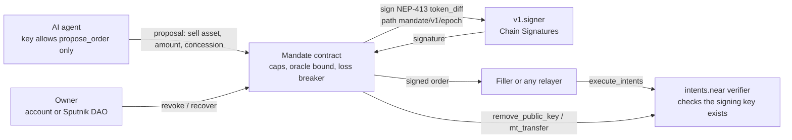
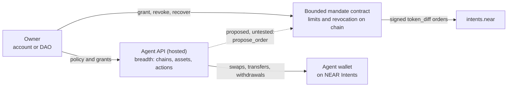

# Bounded mandate

**An AI agent trades a USDC/wNEAR treasury on NEAR Intents, only through a contract that enforces its limits and signs every order itself.**\
**Revoking the grant removes the contract's signing key from `intents.near`; once that is confirmed, every order already signed for the grant fails, withheld ones included.**\
**The owner then takes the assets back without the agent, the oracle or the signing network.**

Sandbox-certified at revision 4fec11b (fresh clone and CI); evidence in [evidence/4fec11b](evidence/4fec11b). No mainnet transaction has been executed.


## Try it

```sh
git clone https://github.com/gryyny/bounded-mandate.git && cd bounded-mandate   # private until the lead publishes it
make test    # every acceptance gate; 1447 s cold in a macOS arm64 fresh clone at 4fec11b
make demo    # the unfunded sandbox story; 62 s on the warm build
open out/page/index.html out/console/index.html   # evidence page and owner console (xdg-open on Linux)
```

No funds, model key or private repository. Platform needs, expected output and what each command proves are under [For reviewers](#for-reviewers).

## Why NEAR

- **A contract owns its Intents settlement account and signs for it.** The mandate contract is the account on `intents.near` that holds the treasury, and it gets every signature for that account from `v1.signer` through Chain Signatures, on its own derivation path `mandate/v1/<epoch>`. No person or server holds the order-signing key. That is what makes revocation a key removal: the contract calls `remove_public_key` on its own Intents account, and the verifier then refuses every order signed with that key. A regrant derives a key on a new path.
- **The NEAR Intents verifier** keeps each account's signing keys on chain (`add_public_key`, `remove_public_key`) and checks that the key exists when it executes a signed intent. Anyone can check the key with a view call.
- **Function-call access keys** restrict the agent's account at the protocol level: calls to other methods, deposits, transfers and key changes are refused before the contract runs (ten of the certified cases in the [attack log](#attack-log)).
- **Permissionless `execute_intents`** lets our filler, or anyone, settle the exact signed bundle; no hosted relayer is trusted.
- **Sputnik DAO** can be the owner, so grant, revoke, recovery and withdrawal become threshold-voted proposals (sandbox; certified at 4fec11b, see [Status](#status)).

## Who needs this and what is next

- **DAO treasuries** that want an agent to rebalance within limits the DAO votes on, and to revoke and recover by proposal.
- **Funds running agents** that need trading limits and revocation they can check on chain rather than take on trust.
- **Agent builders** who want to offer their users a mandate with a verifiable off switch.

These are the users we are building for; there are no customers, revenue or adoption today. Next, in order: an independent security review → one treasury pilot → integrations validated against real callers (for example the Agent API, see [Complementary architecture](#complementary-architecture)).

## For reviewers

| Command | Expected last line | Measured at 4fec11b | What it proves |
| --- | --- | --- | --- |
| `make test` | A line starting `CERTIFIED: run`, followed by the run id and `out/evidence/acceptance.json`. A tree with uncommitted changes ends `COMPLETE BUT UNCERTIFIED (dirty tree)` instead. | macOS arm64 fresh clone: 1447 s cold, including dependency and Chromium downloads and the first build. GitHub Actions ubuntu-24.04, run 42367428212: 2014 s. | All 34 required cases of the 15 gates passed in one run of a clean tree, bound to the revision and the spec, fixture and WASM hashes ([Required gates](#required-gates)). |
| `make demo` | `setup … ms \| story … ms \| 59/59 assertions passed \| browser start … ms (not in setup or story)` | macOS arm64: 62 s warm (setup 15.8 s, demonstration 20.2 s, browser start 0.5 s; the rest is `npm ci` and the cached WASM build). Linux CI: 73 s (setup 14.4 s, demonstration 20.2 s). | The nine-stage revocation story on a local sandbox ([What the demo runs](#what-the-demo-runs)). The 59 assertions are story checks, not acceptance results. |
| Open `out/page/index.html` and `out/console/index.html` | Both open from disk. The page makes no network request before you press its verification button; the console makes none before a button press, except to resume an action already pending in that browser. | Not timed. | The evidence page binds the demo to the acceptance run and shows gates as certified only after `make test` passed on the same clean revision, otherwise "not certified for this demo". The console is the static owner console with no backend: a read-only view, and exact previews of the owner's revoke, recover and withdrawal, signed outside the page. |

Platform needs:
- Rust via rustup; the toolchain (1.97.1, with the `wasm32-unknown-unknown` target) is pinned in `rust-toolchain.toml` and installs on first use.
- `cargo-near` 0.22.0: `cargo install cargo-near --version 0.22.0 --locked`. On Linux install `libudev-dev` and `pkg-config` first.
- Node.js 24 and npm.
- Network access on the first run: crates, npm packages, the NEAR sandbox binary and Playwright's pinned headless Chromium, which both targets download once and reuse.
- On Linux, Chromium's system libraries once: `cd tools && npm ci --ignore-scripts && npx playwright install --with-deps chromium` (as in CI).

### Found and fixed

An independent review of this release found these problems before certification; each fix is in the certified revisions f01b496 through 4fec11b:
- **An owner transaction could be absorbed by a later runner-signed step, and owner keys not in the manifest were invisible.** The runner now requires each signing key's exact chain nonce before every send and import, and snapshots the owner's complete key set; any difference stops the run.
- **The demo claimed a console review and a console revocation without opening the console.** Both now run through the console in headless Chromium.
- **A loose match accepted a relay failure as the effect of revocation.** Only the verifier's exact removed-key error counts, at a rejection block before the order's deadline.
- **Unknown console reads.** They never confirm key removal and never enable withdrawal.
- **The local test signer** is bound to the deployment and the owner.

A second review, of the presentation and release changes, found these before f5e34f9 was certified:
- **The first-screen diagram overstated the guard comparison.** The withheld order revived by a regrant is a second one, which removing the key on Intents had blocked; the diagram and alt text now say so.
- **A video "site check" was claimed but never ran.** The site check now requests both planned video URLs and compares them with the certified cuts in `video.json`; `--video` requires the manifest.
- **Committed evidence recorded machine-local paths.** Gate reports now record repository-relative commands, and acceptance refuses a report that records an absolute path.
- **A T5 test race** (the signer's pending request read once, a block too early) failed one fresh-clone run at 3418307; the test now polls for it.
- **Fees of refused handoffs** are counted against the fee cap.
- **Unrecorded transactions.** A closing check looks for unrecorded owner, agent and filler transactions before a run reports completion.

A third review, after f5e34f9, found implementation gaps that the owner's approvals would have hit; all are fixed and re-reviewed in 4fec11b:
- **No external-wallet connector.** The console now connects the owner's wallet through NEAR Connect, with an in-page wallet list and each adapter checked against a pinned sha256 before it runs (CONSOLE.wallet-sandbox).
- **Provider qualification could not run before the first grant.** The rehearsal now decides on the planned grant, labelled as not on chain.
- **A rejected proposal could still "qualify" the provider.** Only an accepted proposal whose pre-signing checks pass, or a decline, qualifies; the verifier re-derives the claim.
- **The wallet check was planned at a step where Revoke is correctly disabled.** It is now a connection check before the run; the cancelled-signature check happens at the run's first recovery.
- **A closed wallet window counted as a cancellation.** A wallet's error now leaves the action pending until the owner forgets it.
- **Wallet lists and adapter code could be planted** through the shared origin's storage or NEAR Connect's cache. Storage is in memory, the cache holds nothing, and only pinned bytes run.
- **The rehearsal state was not bound to its manifest.** It is now.
- **A fresh clone at 98cc5fe failed the license check**, because NOTICE did not name the wallet fixture. NOTICE now names it and the inlined library.

## What you get

- **Delegation without a key.** The agent proposes trades; it never holds funds or a key that can sign orders or move assets. Its only NEAR key can call `propose_order` and nothing else.
- **Limits the agent cannot change.** Before signing, the contract checks per-order, outstanding and turnover caps, a price concession of at most 0.5% against the oracle, and a 2% loss breaker.
- **Revocation that covers signed orders.** Pausing an agent stops new orders, but orders it already signed stay valid. Here the owner's `revoke` removes the grant's signing key from NEAR Intents; once the removal is confirmed, every outstanding order of that grant fails, including one someone held back, and a later grant signs with a different key.
- **Recovery without dependencies.** `recover` moves both balances to the owner's Intents account with no agent, oracle or signing network involved. Withdrawing from there to the owner's NEAR account is the owner's own later step, outside the recovery claim.

## How it works



1. The owner deposits USDC and wNEAR into the mandate's Intents account and grants trading with fixed limits. The contract derives a fresh Ed25519 key on path `mandate/v1/<epoch>` and registers it on `intents.near`.
2. The agent proposes a sell amount and a concession. The contract reserves exposure, reads both oracle prices and its balances, re-checks every limit, builds the exact order and has the MPC network sign it on the grant's path.
3. A filler counter-signs the other side and settles both through `execute_intents`.
4. `revoke` stops new orders at once and removes the grant's key from `intents.near`. After the removal is confirmed, the verifier rejects every order signed with it.
5. `recover` transfers both balances to the owner's Intents account.

## What the demo runs

Nine stages, in order, on a local sandbox with labelled test doubles and recorded model output:

1. **Grant and limits.** The owner grants; the contract registers the grant's derived key on the verifier, and the initial reference value matches the deposits at the posted prices.
2. **Console review.** The owner console, in headless Chromium, shows the grant status, limits, key presence, fixed accounts and balances exactly as the chain views read them.
3. **Bounded proposal and trade.** The recorded genuine model proposal reaches `propose_order` and is signed; the filler fills it on the pinned verifier and the reservation is released on settlement.
4. **Withheld order.** A second, scripted order is signed; the filler counter-signs a complete bundle, `simulate_intents` accepts it, and it is held back.
5. **Hostile requests.** Every case of the attack suite and the recorded response to an injected prompt is stopped at its boundary.
6. **Revocation through the console.** The owner checks the exact preview and presses Revoke; the transaction is signed by the local sandbox test signer, not a wallet. Removal of the grant's key is confirmed and the withheld order's reservation is released.
7. **Withheld relay rejected.** Another account relays the withheld bundle while it is still unexpired; the verifier rejects it for the removed key, before its deadline, with no balance change.
8. **Recovery.** With the agent stopped, the oracle failing and the MPC on hold, direct owner `recover` calls (not through the console) move both assets to the owner's Intents account.
9. **Owner withdrawal.** Direct owner `ft_withdraw` calls move both assets to the owner's NEAR account, registering wNEAR storage first because the demo starts the owner unregistered there. This is outside every recovery claim.

The 59 assertions are story checks, not acceptance results; their total is derived at run time.

## Ways to evaluate

| Path | Do | See |
| --- | --- | --- |
| Video | Watch the short cut (85.8 s); its URL is **planned, unpublished**: `https://gryyny.github.io/bounded-mandate/video/bounded-mandate-short.mp4`. A longer technical walkthrough (179.7 s) covers the same run plus the attack suite; planned, unpublished: `https://gryyny.github.io/bounded-mandate/video/bounded-mandate-demo.mp4`. Both cuts were rendered from the 4fec11b fresh-clone demo ([video.json](evidence/4fec11b/video.json)); [tools/src/video/make.ts](tools/src/video/make.ts) rebuilds them locally. | The revocation story from one sandbox run: balances, trading limits, a recorded model proposal traded, a signed order withheld, confirmed revocation, the withheld order rejected, balances recovered. |
| Evidence page | Open [evidence/4fec11b/page/index.html](evidence/4fec11b/page/index.html) in a browser (self-contained, no network). Planned hosted copy, **unpublished**: `https://gryyny.github.io/bounded-mandate/` | The outcome against the agent's 50/50 objective, the withheld order's identity and its rejection, the regrant and disclosed-signature sandbox cases, acceptance gates, matched baseline, claims and non-claims, policy and provenance. An opt-in panel (§V) runs read-only checks against a mainnet RPC from the browser; nothing is requested before you press its button. `make demo` regenerates the page at `out/page/index.html`. |
| Owner console (sandbox; certified at 4fec11b, see [evidence/4fec11b](evidence/4fec11b)) | After `make demo`, open `out/console/index.html`. Planned hosted copy, **unpublished**: `https://gryyny.github.io/bounded-mandate/console/` | A static console with no backend. Visitors get a read-only view of policy, grant status, key presence, orders, balances and evidence provenance. The owner's revoke, recover and withdrawal actions are previewed exactly and signed outside the page; the page holds no key or model credential and never resubmits on its own. External wallets connect through NEAR Connect (pinned library, in-page wallet list, adapters pinned by commit). Its browser flow is tested in headless Chromium against the sandbox only, through the labelled local test signer and the labelled sandbox test wallet; no real wallet provider has signed through it yet. |
| Mainnet receipts (pending the approved mainnet run) | Run the read-only commands in [Verify on mainnet](#verify-on-mainnet-read-only) with `curl` and `jq`; no wallet, key or funds | Today: the verifier we test against is byte-identical to the code at `intents.near`. After the approved run: the withheld order's relay receipt failing for the removed key before its deadline, and the recovery receipts: `<MAINNET_RECEIPT_TBD>`. |
| Attack log | Read the [attack log](#attack-log) | Each malicious request, the layer that stopped it, the enforcing source line and the certified result. |

### Verify on mainnet (read-only)

**Pending the approved mainnet run; no mainnet transaction has been executed.** The code-hash check works today. The second block is a template: its placeholders are filled in only after the run, and these commands send no transaction.

```sh
RPC=https://archival-rpc.mainnet.fastnear.com   # archival: receipts stay readable after the run

# Works today: code hash of intents.near ...
curl -sS "$RPC" -H 'Content-Type: application/json' \
  -d '{"jsonrpc":"2.0","id":1,"method":"query","params":{"request_type":"view_account","finality":"final","account_id":"intents.near"}}' \
  | jq -r .result.code_hash
# ... equals base58(sha256) of our verifier fixture (run in this repository)
python3 -c "import hashlib;n=int.from_bytes(hashlib.sha256(open('fixtures/verifier/defuse-0.4.5.wasm','rb').read()).digest(),'big');A='123456789ABCDEFGHJKLMNPQRSTUVWXYZabcdefghijkmnopqrstuvwxyz';s='';exec('while n:\n n,r=divmod(n,58)\n s=A[r]+s');print(s)"
```

Both print `BtA1BEFNS619KkvXFsgcpQ21Tb5yMm32aaUkn7xNothk`, as recorded in [fixtures/manifest.json](fixtures/manifest.json) at block 222913804. A later upgrade of `intents.near` would change the live value.

```sh
# TEMPLATE until mainnet receipts exist. Placeholders: <...>.
MANDATE='<MANDATE_ACCOUNT>'; GRANT_KEY='<ed25519:GRANT_PUBLIC_KEY>'; NONCE='<WITHHELD_ORDER_NONCE_BASE64>'
view() {  # view <contract> <method> <json args>
  curl -sS "$RPC" -H 'Content-Type: application/json' \
    -d "{\"jsonrpc\":\"2.0\",\"id\":1,\"method\":\"query\",\"params\":{\"request_type\":\"call_function\",\"finality\":\"final\",\"account_id\":\"$1\",\"method_name\":\"$2\",\"args_base64\":\"$(printf %s "$3" | base64 | tr -d '\n')\"}}" \
    | jq -r '.result.result | implode'
}
view intents.near has_public_key "{\"account_id\":\"$MANDATE\",\"public_key\":\"$GRANT_KEY\"}"  # current state only: false now, not when it was removed
view intents.near is_nonce_used "{\"account_id\":\"$MANDATE\",\"nonce\":\"$NONCE\"}"           # current state only: the verifier can clean up expired nonces
view "$MANDATE" get_grant '{}'                                                               # grant epoch and state
curl -sS "$RPC" -H 'Content-Type: application/json' \
  -d '{"jsonrpc":"2.0","id":1,"method":"tx","params":{"tx_hash":"<TX_HASH>","sender_account_id":"<SENDER_ACCOUNT>","wait_until":"FINAL"}}' \
  | jq '.result.receipts_outcome[] | {executor: .outcome.executor_id, status: .outcome.status}'  # per-receipt outcomes
```

The two views above show current state only. The historical proof is the relay transaction's receipts: the verifier receipt fails with the removed-key error in a block before the order's deadline. `has_public_key` cannot say when a key was removed, and `is_nonce_used` can read `false` for a used nonce after the verifier's garbage collector cleans up expired nonces. The evidence page's opt-in panel checks the receipts this way.

## Status

| Area | State |
| --- | --- |
| Core mandate: bounded trading, grant-wide revocation, regrant, conservative accounting, recovery | **Certified in sandbox** at 4fec11b (earlier at f5e34f9, 0e915a2, f01b496 and f60f999): every required case of every gate passed in one run of a clean tree, in an independent fresh clone and in CI. Our contract and the exact mainnet Intents verifier WASM execute; the MPC signer, oracle and tokens are labelled test doubles. |
| Model input | A genuine recorded `claude-haiku-5-5` interaction is replayed into `propose_order` (MODEL gate). No gate or demo calls a model. |
| Mainnet | **Not run.** It needs the lead's separate setup and runner approvals of exact accounts and budget. Receipts: `<MAINNET_RECEIPT_TBD>`. |
| Static owner console | Implemented; sandbox; certified at 4fec11b, see [evidence/4fec11b](evidence/4fec11b). Tested in headless Chromium against the sandbox through the labelled local test signer, not a wallet: CONSOLE.browser-sandbox (revoke, recovery and withdrawal of both assets through the console, each imported and verified by the runner) and CONSOLE.access-controls (a wrong owner, network or deployment disables every control; a cancelled signature, a rejected transaction and a reload during a pending action resubmit nothing). External wallets: CONSOLE.wallet-sandbox runs the NEAR Connect path end to end with the labelled sandbox test wallet (picker, sandboxed adapter, a rejection in the wallet and a closed wallet window, both leaving the action pending until the owner forgets it, signing, the runner's import, a reload, a framed page, another account, adapter bytes checked against their pin, planted wallet lists and adapter caches ignored). The eight pinned real wallet adapters were fetched, matched their recorded sha256 and loaded under the console's CSP without an account (`tools/src/console/wallets-check.ts --browser`; report in the evidence bundle's `console/wallet-adapter-check.json`, network-dependent and not part of `make test`); no real wallet provider has signed through the console yet. |
| Owner withdrawal of both assets from the owner's Intents account to its NEAR account (`ft_withdraw`) | Implemented; sandbox; certified at 4fec11b, see [evidence/4fec11b](evidence/4fec11b). Runner-signed and imported external steps (WITHDRAW.both-assets, WITHDRAW.unregistered-owner, WITHDRAW.failed-receipt-retry). The owner's own action, outside the contract and outside every recovery claim. |
| Sputnik DAO as owner | Sandbox; certified at 4fec11b, see [evidence/4fec11b](evidence/4fec11b). DAO.sputnik-owner passes in sandbox against the pinned mainnet factory code (sputnikdao2 2.3.1) with a council of three and 2-of-3 threshold voting: one approval executes nothing; two execute grant, revoke, recovery to the DAO's Intents account and the DAO's own withdrawal. In sandbox the DAO code is deployed onto the owner account rather than created by the `sputnik-dao.near` factory, and the DAO's token storage registration was tested only on the mock token, not on mainnet tokens. |
| Optional live agent with per-order and cumulative sale budgets | Sandbox; certified at 4fec11b, see [evidence/4fec11b](evidence/4fec11b). The runner's remaining budgets are in the agent's snapshot, prompt and validation (AGENT.budget-bounds); the no-transaction rehearsal has run with stub providers only (AGENT.rehearsal), including before any grant on the planned policy and inventory at observed prices; LIVE.agent-template runs the primary template's whole sequence in sandbox with a synthetic provider answer. No live provider is qualified and no paid inference has run. |

Certified results are committed under [evidence/](evidence/) and indexed by source revision in [evidence/index.json](evidence/index.json). Each entry records:
- the acceptance verdict, with every required case of every gate bound to that revision and to the spec, fixture and WASM hashes;
- the environment, commands and exit results;
- an independent fresh-clone run without funds, model credentials or private-repository access.

`evidence/426914d` is an earlier bundle in the legacy report format, kept unchanged; current rules do not certify it. See [SPEC.md](SPEC.md) for the requirements.

### Required gates

A gate passes only when every one of its required cases ([tools/src/evidence/required.ts](tools/src/evidence/required.ts)) passed in one run of a clean revision. T1 to DEPLOY were first certified at f60f999; DAO to CONSOLE were added, and all required cases were first certified together at f01b496 (33 then). CONSOLE.wallet-sandbox was added at 4fec11b, where all 34 passed.

- **T1**: a withheld signed order relayed after revocation, after regrant, during pending signing and activation, and after failed removal and retry.
- **T2**: seeded randomized interleavings, in unit tests and in sandbox, with no cap violation and no double release.
- **T2b**: a signature disclosed while the mandate's callback fails stays accounted for when relayed independently.
- **T3**: the 0.5% concession bound on every fill, feed and timing checks, and the loss breaker.
- **T4**: recovery with the agent, oracle and MPC unavailable, at the record bound and the open-order limit, and after registration reconciliation.
- **T5**: the matched baseline.
- **BOUNDARY**: the contract's own boundary cases and the attack suite.
- **MODEL**: a recorded genuine model proposal reaches `propose_order`.
- **DEPLOY**: the proposed deployment binary (reproducible-build fixture) exercised in sandbox.
- **DAO**: a pinned Sputnik DAO (mainnet factory code) as the fixed owner, threshold-voted, in sandbox.
- **AGENT**: the runner's sale budgets in the agent's snapshot, prompt and validation, and the no-transaction provider rehearsal with stub providers (on an observed grant, and on the planned grant before one exists).
- **HANDOFF**: external owner actions persisted as intents and imported by transaction hash; refusals of altered, unrelated and duplicate imports; lost-response resume; an unrecorded owner transaction stops the run.
- **WITHDRAW**: the owner's `ft_withdraw` of both assets after recovery, with an unregistered owner and a failed receipt retried, outside recovery claims.
- **LIVE**: the primary live-agent template's full sequence in sandbox on the exact deployment binary, with a synthetic provider answer.
- **CONSOLE**: the owner console in headless Chromium against sandbox through the labelled local test signer and, through NEAR Connect, the labelled sandbox test wallet; neither is a real wallet provider.

The owner-key rescue (RESCUE.owner-key) is reported separately and never counts toward a gate.

## What it guarantees, and what it does not

The claim: after removal of the grant's signing key is confirmed, withheld signed orders fail, including after a regrant; the owner recovers the remaining assets without the agent, oracle or MPC.

Not guaranteed: principal, profit, execution availability or a maximum total loss. Market moves, stale references, fees and orders still executable when the loss breaker trips can lose more than the stated 0.5% execution concession. While revocation is pending, already-signed orders may still execute. The owner is trusted. The contract has no upgrade method: upgrade and emergency-rescue authority exist only if the deployment leaves the owner a full-access key on the mandate account (the demo deploys without one). NEAR, the Intents verifier and its admins, and the token contracts must keep working.

## Attack log

Every row is a request the certified attack suite ([tools/src/attacks/suite.ts](tools/src/attacks/suite.ts)) or a revocation gate sent in the sandbox at 4fec11b. "Stopped by" is the layer that actually refused it, classified from the observed error rather than assumed, and each case also checks that grant, orders, balances and keys were unchanged. Results: [BOUNDARY.attacks](evidence/4fec11b/tests/BOUNDARY.attacks.json) (39 of 39 cases stopped at the expected layer and contained) and the T1 and T2b reports linked below. Source lines are at revision 4fec11b (unchanged since 78e2832); the contract source is unchanged since the certified revision, and the tools lines were rechecked there.

| Attack | Cases | Stopped by | Enforcing source | Certified result |
| --- | --- | --- | --- | --- |
| Model output that adds a recipient, raw payload, MPC path, public key or raw token id, names a forbidden asset, a negative amount or an out-of-range concession, asks for a withdrawal, or is not JSON | 10 `adapter-*` | Adapter schema, before any transaction | Strict decision union [tools/src/agent/decision.ts#L7-L10](tools/src/agent/decision.ts#L7-L10); proposal shape [tools/src/types.ts#L12-L18](tools/src/types.ts#L12-L18); [`judge`](tools/src/agent/decision.ts#L66-L71) | Rejected; nothing sent |
| The same requests sent straight to the chain with the agent's key, plus an amount of 2^128 | 7 `direct-*` | Contract input schema | `Proposal` with `deny_unknown_fields`, `Asset` enum and `U128` [contract/src/types.rs#L27-L38](contract/src/types.rs#L27-L38) | Deserialization fails; state unchanged |
| Zero amount, amount 2^128-1, 400 USDC above the 20% per-order cap, 51 bps concession | 4 `direct-*` | Contract policy | [contract/src/lib.rs#L429-L430](contract/src/lib.rs#L429-L430) (amount), [#L440-L443](contract/src/lib.rs#L440-L443) (concession), [#L461](contract/src/lib.rs#L461) and [#L903-L906](contract/src/lib.rs#L903-L906) (per-order cap) | Panics with the named limit; state unchanged |
| Agent key calls `revoke`, `grant`, `recover`, `on_signed` or `settle_order`, attaches a deposit, calls `mt_transfer` or `add_public_key` on the verifier, sends NEAR, or adds a full-access key | 9 `agent-*` and `direct-deposit` | NEAR protocol: the agent's function-call key (receiver mandate, method `propose_order`, no deposit) | Enforced by nearcore before any contract runs. Our setup creates the key at [tools/src/demo/world.ts#L119-L123](tools/src/demo/world.ts#L119-L123) via [tools/src/near/sandbox.ts#L59](tools/src/near/sandbox.ts#L59); the live preflight refuses any other agent key ([tools/src/live/preflight.ts#L236-L247](tools/src/live/preflight.ts#L236-L247)) | Transaction refused; not executed |
| Another account calls `propose_order`, `grant`, `revoke` or `recover` | 4 `attacker-*` | Contract role check | [contract/src/lib.rs#L420-L423](contract/src/lib.rs#L420-L423) (agent only); [`assert_owner`](contract/src/lib.rs#L927-L932), called first by [`grant`](contract/src/lib.rs#L283-L284), [`revoke`](contract/src/lib.rs#L325-L326) and [`recover`](contract/src/lib.rs#L384-L385) | "only the agent may propose" / "only the owner"; state unchanged |
| Another account calls a callback (`on_signed`, `on_key_removed`, `on_recovery_transferred`) | 3 `attacker-callback-*` | Contract: `#[private]` callbacks | [`on_signed`](contract/src/lib.rs#L727-L728), [`on_key_removed`](contract/src/lib.rs#L656-L657), [`on_recovery_transferred`](contract/src/lib.rs#L829-L830) | "Method ... is private"; state unchanged |
| A relayer submits a transfer-to-attacker intent claiming the mandate as signer, signed by an unregistered key | `forged-mandate-transfer` | NEAR Intents verifier (exact mainnet WASM [fixtures/verifier/defuse-0.4.5.wasm](fixtures/verifier/defuse-0.4.5.wasm)) | Key check in the declared source, [near/intents@16d04f6 engine/mod.rs#L70-L73](https://github.com/near/intents/blob/16d04f6ec4401263f8914638710260da50bb46b0/contracts/defuse/core/src/engine/mod.rs#L70-L73) | "public key ... doesn't exist for account"; nothing moved |
| A signed order is withheld, the owner revokes, and another account relays it before its deadline; again after a regrant | T1 withheld-regrant | Verifier key check after confirmed removal; a new derivation path per grant | Revocation [contract/src/lib.rs#L325](contract/src/lib.rs#L325), release on confirmed removal [#L1001-L1002](contract/src/lib.rs#L1001-L1002), path `mandate/v1/<epoch>` [contract/src/state.rs#L54](contract/src/state.rs#L54); verifier check as above | [Rejected; zero executions after confirmed removal, none revived after regrant](evidence/4fec11b/tests/T1.withheld-regrant.json) |
| The MPC publishes a valid signature while the mandate's callback fails, and the order is relayed independently | T2b | Contract accounting: no release without trusted evidence | Release rules [contract/src/lib.rs#L53-L59](contract/src/lib.rs#L53-L59); unknown signing outcome stays reserved [#L757-L759](contract/src/lib.rs#L757-L759) | [Order stays reserved, settles on evidence and fails after removal](evidence/4fec11b/tests/T2b.callback-failed-after-disclosure.json) |

The contract's own boundary cases (67 sandbox cases, all rejected at their boundary) are in [BOUNDARY.contract](evidence/4fec11b/tests/BOUNDARY.contract.json). Permitted but poor trades are not attacks the mandate stops: they are bounded by the caps, the concession limit and the loss breaker (T3).

## Mechanism in detail

- **Agent.** A separate account whose only key is a function-call key for `propose_order` with a finite allowance. A proposal names only the asset to sell, the amount and a concession of at most 50 bps. It cannot name recipients, payloads, keys, paths or token IDs.
- **Contract.** It reserves exposure and charges turnover before any external call, reads both oracle prices and its verifier balances, re-checks every cap and the loss breaker, then builds an exact NEP-413 `token_diff` with a versioned nonce and a short deadline. It signs through its own MPC derivation path `mandate/v1/<epoch>`, which is never reused.
- **Accounting.** A reservation is released exactly once, and only on trusted evidence: the verifier reports the nonce used, block time passes the deadline, or removal of the covering key is confirmed. A signature published by the MPC whose callback failed stays reserved. Every proposal permanently charges at least `proposal_charge_bps` of turnover, so a grant accepts at most `turnover_cap / proposal_charge` proposals. The charge consumes authorization capacity; no tokens move and no fee is paid. It bounds order records per grant, not storage across grants (each regrant is an owner decision). At most 32 orders are open at once, so confirmed removal releases them all within one callback's fixed gas.
- **Revocation.** Key registration and removal are serialized. Revocation stops new authorization at once (`revoking`); confirmed removal (`revoked`) releases every reservation of that grant. Failed removal can be retried.
- **Unresolved registration.** If the key-registration callback fails, the owner calls `reconcile_registration`. It resolves only on observing the grant key registered on the verifier; absence or elapsed time never resolves it, because a pending registration could still land. If both the registration and its callback failed, an emergency rescue is needed: confirm from final receipt outcomes that nothing can still register, re-add the key with an owner-held key on the mandate account, then reconcile and revoke. That rescue is reported separately from ordinary recovery and is impossible for a keyless deployment.
- **Recovery.** With the grant revoked, the owner moves each asset's verifier balance to the owner's Intents account with `mt_transfer`. No price read, signature or agent action is involved. This is not a withdrawal to an external wallet; moving funds out of Intents is the owner's own later action.
- **Owner withdrawal (sandbox; certified at 4fec11b, see [evidence/4fec11b](evidence/4fec11b)).** After recovery the owner, not the contract, withdraws each asset from its own Intents account to its NEAR account with `ft_withdraw` on the verifier, registering token storage only where needed. A failed withdrawal leaves the Intents balance intact and is retried without double counting. It is outside every recovery claim.
- **Filler.** Our own separately keyed account signs the matching side, pays the verifier fee, and submits both payloads through permissionless `execute_intents`. It never builds a replacement order after an ambiguous result.

Demo policy: per-order and outstanding caps 20% of the initial reference value, turnover cap 100%, concession at most 0.5%, oracle age at most 60 s, confidence at most 0.5%, loss breaker at 2% drawdown, deadline at most 60 s, and a per-proposal charge of 0.5%. These are demonstration settings, not proven production risk limits. With this policy, the measured storage requirement for a full grant (200 proposals of about 780 bytes each, plus grant state) is about 4.67 NEAR in total for the mandate account, including about 3.1 NEAR for the contract code.

## Matched baseline (T5)

We applied the same threat model to our own re-implementation of the [Claw Guard](https://github.com/metafrogmeme-droid/claw-guard-near) design (pinned 225d37d), adapted to the same USDC/wNEAR `token_diff` authority on the pinned Intents verifier. Results describe that re-implementation in a local sandbox, not the deployed Claw Guard product; the adaptations are recorded with the results. Executed in sandbox:

- its own revocation (pause and remove the agent) leaves withheld signed orders executable;
- removing the key on Intents stops them, but a regrant re-registers the same fixed-path key and revives them;
- a signature disclosed while the signer callback fails is released from accounting, so executed volume exceeded its daily cap.

Over-cap, injected-withdrawal and owner-recovery cases are blocked by both designs. The evidence page claims an increment only from a certified run in which the matching mandate gate passed.

## Comparison with related NEAR projects

What this repository demonstrates together, in the sandbox gates certified for revision 4fec11b [1]:

1. **Bounded trading.** The agent only proposes; before signing, the contract enforces per-order, outstanding and turnover caps, a price bound against the oracle and a loss breaker (T2, T3, BOUNDARY).
2. **Grant-wide invalidation.** Once removal of the grant's key on `intents.near` is confirmed, every outstanding signed order of that grant fails, including orders someone withheld (T1).
3. **Fresh authority after regrant.** Each grant signs with a key on a new derivation path, so a regrant does not revive earlier orders (T1).
4. **Conservative accounting.** A reservation is released only on verifier evidence; a signature that was disclosed while the signing callback failed stays reserved (T2b).
5. **Owner recovery.** `recover` moves both assets to the owner's Intents account without the agent, oracle or MPC (T4).

None of it has run on mainnet yet.

**The official NEAR Intents Agent API** [2, 9] is the closest product, and it is much broader. One owner-signed policy covers actions, assets, per-asset limits, a USD budget, destinations, a timelock, a schedule, owner approval and a freeze, for swaps, transfers and withdrawals to many chains. It is a hosted service in an attested Intel TDX VM with a signed transparency log for every execution; its source is not public yet, so the running images can be checked but not rebuilt. A partner backend acts with a grant token, a bearer credential the owner signs for. Its routes differ in what the backend gets back, so they are compared separately:

- **Hosted actions** (`POST /v1/agents/{agent_id}/swap`, `transfer`, `withdraw`, `shield`, `unshield`): the API and the agent's wallet execute the action; the backend receives a status, not a signed order. Revoking a grant or changing the policy refuses every action that has not reached its dispatch commitment, and a freeze refuses every action; actions past the dispatch commitment cannot be recalled. There is no signed Intents order for the backend to hold back, and the documentation does not describe these routes as returning a signature [2].
- **Native signing routes** (off until the owner switches each on in the policy's `native` block): the API signs with the agent's own NEAR, EVM or Solana key and returns the signature to the backend once, without broadcasting it: NEP-413 messages for listed relying parties, EVM and Solana messages and transactions, EVM typed data. The policy's destinations, budget, timelock, schedule and approval do not apply to them. A NEP-413 signature already issued stays valid for its relying party until that party expires the nonce. The NEAR key can never sign for or call `intents.near` [2, 9].
- **`evm/sign-intent` and `solana/sign-intent`** (off unless the owner sets `evm.sign_intent` or `solana.sign_intent`) [9]: the EVM or Solana key signs a NEAR Intents payload (`transfer` intents only, `signer_id` = that key's own Intents account) and the route returns it to the caller, who publishes it (1Click, `intents.near` or a solver relay). The policy's destinations, assets, limits, budget, timelock, schedule and owner approval do not apply; the owner's own `sign_intent` rules do (receivers, 1Click deposits, withdrawal addresses, slippage). Anyone holding a signed payload can publish it until its deadline: up to 96 hours for one that pays only 1Click deposits, otherwise 300 seconds. The examples README says: "Freezing the account refuses new payloads but cannot recall one already signed." These routes are documented in the examples repository at commit `2552895`, read 2026-11-06; the hosted Native Accounts page we read the same day did not list them.

This is documentation evidence, not a tested weakness. We have not called the Agent API; the examples README itself states this behaviour and advises listing only the owner's own withdrawal addresses and signing payloads that are due soon. Ordinary hosted execution is not described this way.

This project makes a narrower trade-off: one NEAR contract enforces the limits and signs every Intents order, revocation is a key removal on `intents.near` that voids the grant's outstanding signed orders and that anyone can check with a view call, and the owner's recovery is a contract call that involves no agent, oracle, MPC or API. It covers one asset pair.

How to read the table. Each project was read at the pinned commit or on the dated documentation listed under Sources; later versions may differ. The projects solve different problems, and several are broader than this one; the table compares only how they handle delegated authority. Each cell names its basis: **D** documented in the project's README or docs, **S** read in its source at the pinned commit, **E** executed by us. "Not documented" means we found no statement, not that the feature is missing.

| Project | Where limits are enforced | What revocation invalidates | After regrant | Uncertain or disclosed signatures | Recovery: destination and dependencies | Public reproducibility |
| --- | --- | --- | --- | --- | --- | --- |
| **Bounded mandate** (this repository) [1]. Agent trading of USDC/wNEAR from a contract-owned Intents account. Sandbox only so far. | In the mandate contract, before it signs: caps, oracle price bound, loss breaker. E | New proposals at once. After confirmed removal of the grant's key on `intents.near`: every outstanding signed order of the grant, withheld ones included. E | A new key on a new path (`mandate/v1/<epoch>`); earlier orders stay invalid. E | Released only on verifier evidence; a signature disclosed while its callback failed stays reserved. E | Owner `recover`: `mt_transfer` to the owner's Intents account, with no agent, oracle or MPC; needs NEAR, `intents.near` and the token contracts. E | Gate tests and certified evidence in this repository; the DEPLOY gate deploys a pinned reproducible build of the contract. E |
| **NEAR Intents Agent API** (official, hosted) [2, 9]. Agent wallets on NEAR Intents under an owner-signed policy: swaps, transfers, withdrawals, confidential balances; optional native signing with the agent's own keys. | Hosted actions, two layers: the API (destinations, USD budget, timelock, schedule; it also counts per-asset limits and the action rate) and the agent's wallet provider (actions, assets, limits, rate, owner approval, freeze). Native routes: only the owner's per-method switch, with the grant, freeze and, for NEAR transfers and calls, assets and limits; `evm/sign-intent` and `solana/sign-intent` add the owner's own `sign_intent` rules [9]. D | Hosted actions: `grant_revoke` or a policy change refuses actions that have not reached their dispatch commitment; queued ones fail with `authorization_stale`. A freeze, an on-chain wallet request, refuses every action. Dispatched actions cannot be recalled. Revoking a grant is an owner-signed message checked by the API, not a chain transaction. Native routes: revocation stops new requests; a NEP-413 signature already returned stays valid for its relying party until the nonce expires. `evm/sign-intent` and `solana/sign-intent`: a signed Intents payload already returned can be published by whoever holds it until its deadline, and a freeze cannot recall it [9]. Recall of other returned EVM or Solana signatures: not documented. D | A new grant needs a new token; a reused one is refused. All grants share one policy and one budget. D | Hosted actions: an `UNCERTAIN` action keeps its budget charge and limit count until its outcome is known; the charge is released only when the provider provably refused or never ran the action. Native signatures are returned at once and recorded in the agent's history, without the signature itself [9]. D | Funds stay in the agent's wallet on NEAR Intents. Documented exits are `withdraw` and `transfer` actions under a grant, to policy destinations. An owner exit that does not use the API: not documented. D | Attested VM with published compose and image digests, and per-execution transparency proofs. Source not public yet: images can be checked, not rebuilt. D |
| [Veto](https://github.com/0xdopewilly/veto) @a784344 [3]. Payment vault in which an AI screen in a TEE can only veto. Pays on NEAR, on Base through Chain Signatures, from OutLayer wallets and from an Agent API wallet whose grant Veto holds. Testnet; the Agent API path on mainnet. | Vault contract: per-payment and weekly caps, and an enclave-signed verdict checked on-chain. Agent API path: the owner's API policy, with Veto screening before it uses the grant. D, S | `freeze` stops new payments and cancels pending overrides; it does not change EVM payouts the MPC already signed. How such a payout is stopped afterwards: not documented. The owner can also deactivate or remove a single agent (`set_agent_active`, `remove_agent`). Agent API path: Veto holds the wallet's only grant, so the owner's Agent API controls apply. S, D | Not documented. | Spend is recorded before the MPC request and released if the MPC call returns a failure. A signature disclosed while the callback fails: not documented. S | `withdraw_to_owner` at any time, only to the owner; needs the token contract. S | Public source and tests; a script compares a local build with the code hash deployed on testnet. D |
| [Allowance](https://github.com/soldanoandrea/allowance) @74edffe [4]. Payment vault in which each agent is a function-call key on the vault account. No NEAR Intents in this version; the testnet run is prepared, not run. | The protocol (method-scoped key, no deposits) and the vault contract on every `pay`. D | `kill` pauses, denies queued approvals and deletes every agent key, so the next transaction signed with one is rejected by the protocol. `remove_agent` does the same for one key. D, S | Not applicable in the same form: an agent signs its own NEAR transactions with its function-call key rather than holding standing signed orders. `add_agent` registers a key the owner supplies. S | Not documented. | Owner `withdraw` / `withdraw_ft`, to the owner or a named account. S | Public source, CI, unit tests and a sandbox end-to-end test. The hackathon build is not reproducible; a NEP-330 descriptor is kept. D, S |
| [Agent Treasury](https://github.com/iskander-kudashev-13/agent-treasury) @46116b1 [5]. USDC vault with per-agent mandates for payroll and cross-chain payouts via 1Click, plus an optional Hyperliquid spot trading agent. Mainnet vault with real payouts and a mainnet trading session. | Payments: in the vault contract. Trading rules: in the off-chain worker, as owner-signed rule sets. D, S | `pause_agent` and `revoke_agent` stop vault payments. The trading kill switch halts bots; open positions stay, and the full stop is revoking the API wallet on Hyperliquid. D, S | Vault: `revoke_agent` is terminal and a new agent is needed. Hyperliquid API wallet: not documented. S | Not documented. | Owner `withdraw` from the vault, which pause does not block. Funds already sent to Hyperliquid return manually. D, S | Public source and contract tests; the mainnet vault is a reproducible build. D |
| [NEAR Private OTC](https://github.com/Watchmeecryt/near-private-otc) @55d5b64 [6]. Private OTC deal board: sealed terms in an OutLayer TEE, atomic settlement through `execute_intents`. Hosted app on testnet. | No delegated trading limit. The enclave checks that the two intents mirror each other; for an agent, the limit is its account balance. D | Per deal: the maker burns the nonces of its live offers, so those signatures can never settle. D, S | No grant: each party signs with its own key. D | Not documented. | Assets stay in each user's own verifier balance; the user withdraws with a self-signed `ft_withdraw`. D, S | Public source; the verifier's code hash and the enclave's WASM hash are published. A test suite: not documented. D |
| [Near-LEASH](https://github.com/soze-ki/Near-LEASH) @b122410 [7]. Policy gate for agent spending: EVM transactions through Chain Signatures and funding of 1Click swaps. Testnet, with a live MPC-signed Base Sepolia payment. | In the contract: allowlists, caps, cooldown and on-chain 1Click quote verification. D, S | `pause` and `remove_agent_key` stop new requests. An EVM transaction that was already signed stays valid, subject to its EVM nonce. D, S | `add_agent_key` adds a NEAR key, which signs requests rather than standing orders. Already-signed EVM transactions are governed by their EVM nonce (see the previous column). S | Design spec: a failed or timed-out MPC callback refunds the window debit. D | Owner `withdraw` of NEAR or NEP-141 tokens. S | Public source with unit and sandbox tests; the Intents path has not run on mainnet. D |
| Claw Guard design, our adaptation (T5) [8]. Our re-implementation of the [Claw Guard](https://github.com/metafrogmeme-droid/claw-guard-near) authority model, adapted to Intents `token_diff`; not their deployed product. | In the guard contract: per-order and daily caps. E | Pause or remove-agent: new proposals only; a withheld order executed. Removing the key on Intents stopped it. E | The same fixed-path key is re-registered, and a second withheld order that the key removal had blocked then executed. E | A signature disclosed while the signer callback failed was released, and executed volume exceeded the daily cap. E | Assets stay in the owner's own Intents account; the strand case was blocked. E | Claw Guard: CI reproducible build and a mainnet deployment (D). Our adaptation: [baseline/claw-guard-adapted](baseline/claw-guard-adapted) and the T5 evidence (E). |

Sources:
1. This repository; gates executed at source revision `4fec11b`: [`propose_order`](contract/src/lib.rs#L419), [`revoke`](contract/src/lib.rs#L325), [`recover`](contract/src/lib.rs#L384), [per-grant path](contract/src/state.rs#L54); certified [acceptance](evidence/4fec11b/acceptance.json), [T1 withheld/regrant](evidence/4fec11b/tests/T1.withheld-regrant.json), [T2 interleavings](evidence/4fec11b/tests/T2.sandbox-interleavings.json), [T2b](evidence/4fec11b/tests/T2b.callback-failed-after-disclosure.json), [T3 concession](evidence/4fec11b/tests/T3.concession.json), [T3 breaker](evidence/4fec11b/tests/T3.breaker.json), [BOUNDARY](evidence/4fec11b/tests/BOUNDARY.contract.json), [T4](evidence/4fec11b/tests/T4.dependency-failure.json), [DEPLOY](evidence/4fec11b/tests/DEPLOY.candidate.json).
2. NEAR Intents Agent API documentation, read 2026-11-05 and reread 2026-11-06 (the native routes were added to the comparison then; the hosted action routes and dispatch commitment rechecked that day): [How it works](https://docs.agentsonintents.com/integration/agent-api/concepts) (pieces, two enforcement layers, owner powers, which owner requests are written on chain), [Policies & Limits](https://docs.agentsonintents.com/integration/agent-api/policies-and-limits) (policy fields, which layer enforces what, freeze, policy change and `authorization_stale`, budget charge release, native rules), [Grants](https://docs.agentsonintents.com/integration/agent-api/grants) (bearer token, revocation, committed actions, token reuse), [Executions](https://docs.agentsonintents.com/integration/agent-api/executions) (dispatch commitment, timelock queue, the `recover` endpoint for undispatched uncertain actions), [Native Accounts](https://docs.agentsonintents.com/integration/agent-api/native-accounts) (native routes, what applies to them, issued NEP-413 signatures stay valid until the nonce expires, `intents.near` never signed for or called), [Status & Errors](https://docs.agentsonintents.com/integration/agent-api/status-and-errors) (`UNCERTAIN`, charge release), [Signing Standards](https://docs.agentsonintents.com/integration/agent-api/signing-standards) (grant revocation is an off-chain consent message; freeze is an on-chain wallet request), [Owner Signing](https://docs.agentsonintents.com/integration/agent-api/owner-signing) (withdraw before delete), [TEE & Attestation](https://docs.agentsonintents.com/integration/agent-api/tee) (TDX VM, funds outside it, source not public yet), [Transparency](https://docs.agentsonintents.com/integration/agent-api/transparency) (per-execution proofs).
3. Veto at `a7843443e94fb6c98f42f9139c57e0a0deb3129e`: [README L3-L22](https://github.com/0xdopewilly/veto/blob/a7843443e94fb6c98f42f9139c57e0a0deb3129e/README.md#L3-L22), [tests and deployed-code check L28-L54](https://github.com/0xdopewilly/veto/blob/a7843443e94fb6c98f42f9139c57e0a0deb3129e/README.md#L28-L54), [Agent API path L175-L179](https://github.com/0xdopewilly/veto/blob/a7843443e94fb6c98f42f9139c57e0a0deb3129e/README.md#L175-L179), [status L193](https://github.com/0xdopewilly/veto/blob/a7843443e94fb6c98f42f9139c57e0a0deb3129e/README.md#L193), [`freeze`](https://github.com/0xdopewilly/veto/blob/a7843443e94fb6c98f42f9139c57e0a0deb3129e/contract/src/lib.rs#L685-L698), [`withdraw_to_owner`](https://github.com/0xdopewilly/veto/blob/a7843443e94fb6c98f42f9139c57e0a0deb3129e/contract/src/lib.rs#L869-L880), [`on_evm_signed`](https://github.com/0xdopewilly/veto/blob/a7843443e94fb6c98f42f9139c57e0a0deb3129e/contract/src/lib.rs#L904-L933), [`execute_evm`](https://github.com/0xdopewilly/veto/blob/a7843443e94fb6c98f42f9139c57e0a0deb3129e/contract/src/lib.rs#L1159-L1197).
4. Allowance at `74edffec98cbeffd88d31223802f088c2d0f10b8`: [README L3-L23](https://github.com/soldanoandrea/allowance/blob/74edffec98cbeffd88d31223802f088c2d0f10b8/README.md#L3-L23), [not in this version L511-L513](https://github.com/soldanoandrea/allowance/blob/74edffec98cbeffd88d31223802f088c2d0f10b8/README.md#L511-L513), [testnet L561](https://github.com/soldanoandrea/allowance/blob/74edffec98cbeffd88d31223802f088c2d0f10b8/README.md#L561), [tests L569](https://github.com/soldanoandrea/allowance/blob/74edffec98cbeffd88d31223802f088c2d0f10b8/README.md#L569), [`withdraw`](https://github.com/soldanoandrea/allowance/blob/74edffec98cbeffd88d31223802f088c2d0f10b8/src/lib.rs#L232-L269), [`withdraw_ft`](https://github.com/soldanoandrea/allowance/blob/74edffec98cbeffd88d31223802f088c2d0f10b8/src/lib.rs#L372-L419), [`add_agent`](https://github.com/soldanoandrea/allowance/blob/74edffec98cbeffd88d31223802f088c2d0f10b8/src/lib.rs#L467-L507), [`remove_agent`](https://github.com/soldanoandrea/allowance/blob/74edffec98cbeffd88d31223802f088c2d0f10b8/src/lib.rs#L569-L585), [`kill`](https://github.com/soldanoandrea/allowance/blob/74edffec98cbeffd88d31223802f088c2d0f10b8/src/lib.rs#L657-L684), [build descriptor](https://github.com/soldanoandrea/allowance/blob/74edffec98cbeffd88d31223802f088c2d0f10b8/Cargo.toml#L20-L31).
5. Agent Treasury at `46116b1c88fc5d5068698dc73de348e62f428136`: [README L1-L9](https://github.com/iskander-kudashev-13/agent-treasury/blob/46116b1c88fc5d5068698dc73de348e62f428136/README.md#L1-L9), [reproducible mainnet vault L27](https://github.com/iskander-kudashev-13/agent-treasury/blob/46116b1c88fc5d5068698dc73de348e62f428136/README.md#L27), [limitations L72-L77, L84-L87, L92-L94, L98](https://github.com/iskander-kudashev-13/agent-treasury/blob/46116b1c88fc5d5068698dc73de348e62f428136/README.md#L72-L98), [contract tests L150](https://github.com/iskander-kudashev-13/agent-treasury/blob/46116b1c88fc5d5068698dc73de348e62f428136/README.md#L150), [API wallet L339-L341](https://github.com/iskander-kudashev-13/agent-treasury/blob/46116b1c88fc5d5068698dc73de348e62f428136/README.md#L339-L341), [mainnet demo L454-L470](https://github.com/iskander-kudashev-13/agent-treasury/blob/46116b1c88fc5d5068698dc73de348e62f428136/README.md#L454-L470), [`request_payment`](https://github.com/iskander-kudashev-13/agent-treasury/blob/46116b1c88fc5d5068698dc73de348e62f428136/contract/src/payment.rs#L51), [`pause_agent` / `resume_agent` / `revoke_agent`](https://github.com/iskander-kudashev-13/agent-treasury/blob/46116b1c88fc5d5068698dc73de348e62f428136/contract/src/agent.rs#L126-L156), [`withdraw`](https://github.com/iskander-kudashev-13/agent-treasury/blob/46116b1c88fc5d5068698dc73de348e62f428136/contract/src/owner.rs#L285-L287).
6. NEAR Private OTC at `55d5b645bc6212cf975474cee12f1a63e9a37d55`: [README L3](https://github.com/Watchmeecryt/near-private-otc/blob/55d5b645bc6212cf975474cee12f1a63e9a37d55/README.md#L3), [verifier hash L43](https://github.com/Watchmeecryt/near-private-otc/blob/55d5b645bc6212cf975474cee12f1a63e9a37d55/README.md#L43), [settlement L47](https://github.com/Watchmeecryt/near-private-otc/blob/55d5b645bc6212cf975474cee12f1a63e9a37d55/README.md#L47), [cancel L99](https://github.com/Watchmeecryt/near-private-otc/blob/55d5b645bc6212cf975474cee12f1a63e9a37d55/README.md#L99), [enclave hash L201](https://github.com/Watchmeecryt/near-private-otc/blob/55d5b645bc6212cf975474cee12f1a63e9a37d55/README.md#L201), [keeper cancel L323-L334](https://github.com/Watchmeecryt/near-private-otc/blob/55d5b645bc6212cf975474cee12f1a63e9a37d55/keeper/index.mjs#L323-L334), [keeper withdraw L335-L339](https://github.com/Watchmeecryt/near-private-otc/blob/55d5b645bc6212cf975474cee12f1a63e9a37d55/keeper/index.mjs#L335-L339), [agent limits AGENTS.md L89-L99](https://github.com/Watchmeecryt/near-private-otc/blob/55d5b645bc6212cf975474cee12f1a63e9a37d55/AGENTS.md#L89-L99).
7. Near-LEASH at `b122410aac152d8a38aa36ebe064baf42c91fc10`: [README L3-L16](https://github.com/soze-ki/Near-LEASH/blob/b122410aac152d8a38aa36ebe064baf42c91fc10/README.md#L3-L16), [tests L20-L23](https://github.com/soze-ki/Near-LEASH/blob/b122410aac152d8a38aa36ebe064baf42c91fc10/README.md#L20-L23), [paths L65-L78](https://github.com/soze-ki/Near-LEASH/blob/b122410aac152d8a38aa36ebe064baf42c91fc10/README.md#L65-L78), [`pause`](https://github.com/soze-ki/Near-LEASH/blob/b122410aac152d8a38aa36ebe064baf42c91fc10/contract/src/lib.rs#L366-L370), [`add_agent_key`](https://github.com/soze-ki/Near-LEASH/blob/b122410aac152d8a38aa36ebe064baf42c91fc10/contract/src/lib.rs#L381), [`remove_agent_key`](https://github.com/soze-ki/Near-LEASH/blob/b122410aac152d8a38aa36ebe064baf42c91fc10/contract/src/lib.rs#L409-L415), [`withdraw`](https://github.com/soze-ki/Near-LEASH/blob/b122410aac152d8a38aa36ebe064baf42c91fc10/contract/src/lib.rs#L476-L490), [signed EVM nonce, spec L182](https://github.com/soze-ki/Near-LEASH/blob/b122410aac152d8a38aa36ebe064baf42c91fc10/docs/guardrail-spec.md#L182), [MPC callback failure, spec L183](https://github.com/soze-ki/Near-LEASH/blob/b122410aac152d8a38aa36ebe064baf42c91fc10/docs/guardrail-spec.md#L183).
8. Claw Guard at `225d37d3c1b04959947fa7c18544fa50e273dcd8` (the design T5 re-implements; the later `ff5fdcb` only adds a disclosure to its README): [issued signatures are not revoked by pause, THREAT_MODEL L233](https://github.com/metafrogmeme-droid/claw-guard-near/blob/225d37d3c1b04959947fa7c18544fa50e273dcd8/docs/THREAT_MODEL.md#L233), [DECISIONS L61](https://github.com/metafrogmeme-droid/claw-guard-near/blob/225d37d3c1b04959947fa7c18544fa50e273dcd8/docs/DECISIONS.md#L61), [reproducible mainnet build, README L71](https://github.com/metafrogmeme-droid/claw-guard-near/blob/225d37d3c1b04959947fa7c18544fa50e273dcd8/README.md#L71). Our adaptation: [fixed path](baseline/claw-guard-adapted/src/lib.rs#L27), [`remove_agent` / `pause`](baseline/claw-guard-adapted/src/lib.rs#L298-L310), [test](baseline/claw-guard-adapted/tests/t5_baseline.rs), [certified result](evidence/4fec11b/tests/T5.baseline.json).
9. NEAR Intents Agent API examples repository ([NEAR-Intents-Agent-API/examples](https://github.com/NEAR-Intents-Agent-API/examples), linked from the Native Accounts page) at `25528957276e18ec933eb7d6e8e5c59a5fe033c4`, read 2026-11-06: `07-native-accounts/README.md`, [route table L40-L53](https://github.com/NEAR-Intents-Agent-API/examples/blob/25528957276e18ec933eb7d6e8e5c59a5fe033c4/07-native-accounts/README.md#L40-L53), [revoking a grant stops one caller L59](https://github.com/NEAR-Intents-Agent-API/examples/blob/25528957276e18ec933eb7d6e8e5c59a5fe033c4/07-native-accounts/README.md#L59), [signing returns the signature once and history keeps none L66-L68](https://github.com/NEAR-Intents-Agent-API/examples/blob/25528957276e18ec933eb7d6e8e5c59a5fe033c4/07-native-accounts/README.md#L66-L68), [signing NEAR Intents payloads, deadlines and the freeze L90-L116](https://github.com/NEAR-Intents-Agent-API/examples/blob/25528957276e18ec933eb7d6e8e5c59a5fe033c4/07-native-accounts/README.md#L90-L116), [the NEAR key never reaches the Intents contracts L128-L133](https://github.com/NEAR-Intents-Agent-API/examples/blob/25528957276e18ec933eb7d6e8e5c59a5fe033c4/07-native-accounts/README.md#L128-L133). Documentation only; nothing was executed against the Agent API.

### Complementary architecture

The two fit together rather than compete. The Agent API is for breadth: many chains, assets and action types, hosted execution and per-execution transparency. Bounded mandate is for where trading limits and revocation must be verifiable on chain: the contract checks the limits before it signs, and revocation is a key removal that anyone can check with a view call. An Agent API agent proposing trades to a mandate is a proposed integration, not a built one. It stays untested until two things are tested: caller identity (which account the mandate sees calling `propose_order`; it accepts only its fixed agent account) and invocation compatibility (whether an Agent API route can make that exact call the mandate accepts).



## Layout

| Path | Contents |
| --- | --- |
| [SPEC.md](SPEC.md) | Pinned product specification; origin and hash in [spec-source.json](spec-source.json). |
| `contract/` | Rust mandate contract; `contract/tests/` holds the sandbox and adversarial gate suites. |
| `stubs/` | Labelled test doubles for the MPC signer, oracle and tokens. |
| `baseline/` | Our re-implementation of the Claw Guard design, adapted for the matched comparison. |
| `tools/` | TypeScript model adapter, filler, attack suite, demo, live runner, evidence page, owner console and release checks (`tools/src/release/`: secret scan, site routing and CSP, licenses). |
| `fixtures/` | Pinned external inputs and recorded model interactions, with provenance in `fixtures/manifest.json`. |
| `evidence/` | Curated gate and demo evidence, bound to a source revision. |
| [hosting/](hosting/) | Prepared GitHub Pages workflow, saved disabled, and routing notes. Nothing is published. |

## Requirements

- Rust via rustup (toolchain pinned in `rust-toolchain.toml`) and `cargo-near` 0.22.0 (`cargo install cargo-near --version 0.22.0 --locked`; on Linux install `libudev-dev` and `pkg-config` first).
- Node.js 24 and npm.
- Network access for dependency installation and the first downloads of the NEAR sandbox binary and Playwright's pinned headless Chromium. No funds, model key or private repository access.
- On Linux, Chromium's system libraries: `cd tools && npm ci --ignore-scripts && npx --no-install playwright install --with-deps chromium` once (as in CI).

## Commands

```sh
make test   # all local gates (1447 s cold in the 4fec11b fresh clone)
make demo   # unfunded sandbox scenario, out/evidence/demo.json, out/page/index.html and out/console/index.html (62 s warm at 4fec11b)
MANDATE_LIVE=1 MANDATE_LIVE_MANIFEST=<approved manifest> make live   # opt-in; not spending approval
```

`make test` records a run id, clears earlier results and ends with `tools/src/checks/acceptance.ts`. That step writes `out/evidence/acceptance.json` and fails unless every required case of every gate passed in this run, bound to the revision and the spec, fixture and WASM hashes. A run from a tree with uncommitted changes is never certified. Demo checks are story checks, not acceptance results.

`make live` refuses a manifest that does not match the chain: network, the code hashes of the mandate, verifier, signer, oracle and both token contracts, the verifier, signer and oracle versions, the mandate configuration, keys and allowances. Token decimals are compared with the mandate's configuration, not read from `ft_metadata`; that comparison is a manual pre-approval check. It enforces fee, deposit, inventory and filler caps through a hash-chained ledger that survives restarts. It verifies each step's end state from state and receipts, and stops without any replacement order on an ambiguous outcome. Mainnet also requires `MANDATE_LIVE_CONFIRM=<manifest sha256>`.

A mainnet manifest must list `expected_owner_keys`: the owner account's complete access-key list (public key, permission and nonce) read at approval. A fresh start refuses any difference; a sandbox run without the list snapshots it at preflight. Before every runner-signed transaction and every import, the signing key's chain nonce must equal the ledger's expectation exactly (an imported transaction's nonce must be the next one), and the owner's key list must still match the snapshot. An added or removed key, a changed permission, or a nonce change on a key the ledger does not track stops the run, so an owner transaction the ledger does not record is never absorbed. Resumes check the same.

Preflight also checks each signer's signing float. Before each of its pending transactions, a signer must still hold that transaction's prepaid gas at the purchase price, the higher of the gas price and the runtime's `min_gas_purchase_price`, after the worst-case fees of its earlier steps. This covers the agent's allowance and balance and the filler's and owner's balances. The prepaid gas that is not burnt is refunded later.

There are two mainnet templates, both unapproved; every `REPLACE_ME` value must be filled in, and the runner refuses a template as is. The primary template, [tools/src/live/manifest.live-agent.example.json](tools/src/live/manifest.live-agent.example.json), runs the whole revocation story with small amounts, with the owner's actions signed outside the runner:
1. Grant, then one deliberately forbidden proposal that the mandate itself must refuse.
2. One live agent decision, filled and settled if the agent trades.
3. A second signed order, a fixed proposal from the manifest, withheld: the filler counter-signs a complete bundle, `simulate_intents` accepts it, and the exact bundle is kept in the ledger.
4. Revoke (`revoke_external`), then relay that bundle before its deadline.
5. Recover both assets to the owner's Intents account (`recover_external`).
6. Outside every recovery claim: register the owner's token storage only where it is missing (`register_storage`, runner-signed with the owner key), then withdraw both assets to the owner's NEAR account (`withdraw_external`).

The fallback, [tools/src/live/manifest.example.json](tools/src/live/manifest.example.json), is labelled separately and stays unapproved until the owner authorizes it: the same story with a fixed proposal instead of the agent, runner-signed `revoke` and `recover`, and no owner withdrawals.

**External owner steps.** `revoke_external`, `recover_external` and `withdraw_external` are signed outside the runner, in the owner console or a wallet; `withdraw` is the runner-signed form of the withdrawal. Before the owner signs, the runner records an intent in its ledger and writes it to `out/live/<manifest sha256>/external/step-<n>-<kind>-attempt-<k>.intent.json`. The intent names the signer, the approved key (`keys.owner_external`, else `keys.owner`), the receiver, the complete action list with exact arguments, gas and deposit bounds, and the expected end state. The signer writes `{intent_sha256, tx_hash, signer_id}` to the matching `.handoff.json` file next to it. Until then the run stops as awaiting the owner's signature. `MANDATE_LIVE_HANDOFF_WAIT_SEC` makes it poll for the file first (default 0), a rerun with `MANDATE_LIVE_RESUME=1` imports the file, and `MANDATE_LIVE_HANDOFF=<file>` supplies handoffs to an existing ledger (with `MANDATE_LIVE_RESUME=1`). The runner never submits anything for the owner. With an external wallet, the owner's cancelled-signature check happens at a step that has an action to sign and no deadline: the first recovery. The owner rejects it once in the wallet. The console keeps the action pending, because a wallet's error cannot prove nothing was sent. The owner checks that no transaction appeared and the runner is still awaiting, forgets the record ("I rejected it in the wallet"), then signs. The revocation is signed without that detour, because the withheld order's deadline is running. Before the run, after setup, the wallet check is connection only: the console reads the deployed mandate (chain id, genesis, code hash, verifier, owner), the wallet connects as the owner, and the owner controls enable. Nothing is signed, and Revoke is correctly unavailable because no grant exists yet.

The import looks the hash up at final finality and checks the chain, signer, approved key, receiver, every action and argument, gas and deposit bounds, the key's nonce, the final receipt tree and the expected state and balance changes, then charges the actual fee once. An unrelated, altered or duplicate hash, or a second hash for an intent already handed off, is refused: recorded as refused, never as success, and the run stops. If a refused handoff's transaction is final on chain and the owner paid for it, its fee is recorded and charged once against the fee cap. A transaction that is not yet final records nothing.

**Withdrawals.** Each withdrawal attempt is classified from its final receipts and the token balances before and after: withdrawn, refunded (the token transfer failed and the verifier restored the Intents balance), failed, or inconsistent. A refunded or failed attempt is a finding that leaves the Intents balance intact; a resume retries it once under a new attempt, re-running that asset's storage registration first, and counts no unit twice. The other asset's withdrawal is neither blocked nor repeated.

The relay is checked twice: before the bundle is prepared, and again after signing, immediately before the broadcast. Each check requires confirmed revocation (grant revoked, no key operation in flight, signing key absent) and at least `min_remaining_sec` (10 s) left before the order's deadline by the final block's time. Unconfirmed revocation stops the run; nothing is sent. Too little remaining time skips the relay and records it as inconclusive. A relay that is sent passes only if the verifier rejects it for the removed key, before the order's deadline, with both nonces unused and balances unchanged. An expired order, missing filler funds, a different signature error or an unreadable execution time is inconclusive, never a pass; execution counts as a revocation failure.

Classified terminal outcomes, whether passed, inconclusive, failed or skipped, are recorded and the run proceeds to recovery, exiting nonzero unless every step passed. Unresolved outcomes stop the run without resubmitting anything: a lost response, an outcome that is not final, or an RPC interruption. `MANDATE_LIVE_RESUME=1` reconciles the stopped run from chain state, then continues; a resume never resubmits a transaction whose response was lost, and no step is charged or executed twice. The relay's evidence records the deadline-sensitive phases (withheld order proposed, propose confirmed by runner, bundle simulated, revoke sent, revoke confirmed by runner, relay pre-check, prepared, broadcast) with runner wall-clock times and, where read, the final block's time remaining before the deadline. "Confirmed by runner" is when the step's terminal verification was recorded; after a lost response it is the reconciling resume, never the ambiguous response.

Regrant resistance and broken-oracle or broken-MPC scenarios stay in the sandbox gates. On mainnet, recovery only shows that its receipts call no agent, oracle or MPC; it cannot show those shared services disabled. The template's RPC is `https://free.rpc.fastnear.com`, because `rpc.mainnet.near.org` is deprecated and heavily rate-limited. For lookups of older receipts, such as the verification commands above, use the archival endpoint `https://archival-rpc.mainnet.fastnear.com`.

`make demo` replays the recorded model output, so it needs no API key. To record a new model interaction, run `tools/src/agent/record.ts` with a model provider, then list the file in `fixtures/manifest.json`.

Optional live agent, tested in sandbox only with synthetic provider answers; it has not run against a real model or on mainnet, and no live provider is qualified. In the primary template the trade is proposed by a model (`provider: "near-ai"`, NEAR AI Cloud, the only live provider, key in `NEAR_AI_API_KEY`; an explicit model id, timeout and token limit are required, with one attempt and no fallback). Before deciding, the runner reads fresh oracle prices and the mandate's balances at one final block and records them. If the USD split is within 2 percentage points of 50/50 it records no action without calling the model. Otherwise it accepts only a proposal that sells the overweight asset, no more than needed to reach 50/50 at current prices plus 1% of that amount, within the grant's limits and the runner's remaining per-order and cumulative sale budgets. Those budgets are also in the agent's snapshot and prompt; a proposal above them is rejected, never clipped, while a partial rebalance within the tighter cap is valid. A decline sends nothing. Truncated or invalid output, a reply naming a different model or a timeout is rejected locally before submission: no proposal transaction is sent, and it is recorded as a failed finding. Immediately before signing, the runner reads the prices and balances again and repeats these checks, requiring each price to stay fresh for at least `min_remaining_sec` + 15 s more; a failure there is also a local rejection. If the proposal transaction is submitted and the mandate itself refuses it (its own receipt fails with the grant unchanged, or it rejects the order while pricing), that transaction can consume gas and no trade is filled; the refusal is recorded as a failed finding, and the run continues to revocation and recovery. When no order is made, the following fill and settle are recorded as skipped, never applied to an earlier order. An ambiguous outcome stops the run for reconciliation. The request and the exact response are written to the ledger before any signing. On resume, a recorded decision is reused; a request without a recorded response stops by default, and `MANDATE_LIVE_ALLOW_NEW_DECISION=1` explicitly permits a new, recorded decision, which may incur another inference charge. This 50/50 rule is the agent's objective, not a limit the contract enforces, and model quality, latency and any NEAR AI attestation are not verified here.

[tools/src/agent/rehearsal.ts](tools/src/agent/rehearsal.ts) rehearses the provider path without any transaction: from given observations, the sale budget and the planned inventory (recorded separately from observed balances), it builds the same snapshot and prompt, makes at most one provider call and validates the reply as the runner does. Provider qualification comes before the run that creates the first grant, so before a grant exists it decides on the planned grant: the policy of the approved manifest's grant step and the planned inventory, valued at freshly observed prices. The record labels that basis as planned and not on chain. [tools/src/agent/observe.ts](tools/src/agent/observe.ts) reads those prices, the mandate's verifier balances and its grant (none) at one final block with view calls only, after checking the RPC's chain id and genesis against the manifest. A rehearsal qualifies a provider only when an approved real call from the requested model produced a final decision the runner would act on: an accepted proposal whose pre-signing checks pass, or a decline. A schema-valid answer that the objective, the sale budget or the pre-signing checks reject does not qualify. The record verifier re-derives the claim from the record's own fields; the provider class, the approval reference and the reported model are recorded by the operator, not proven by the record. The state file is bound to the manifest it was observed for, and the record carries that manifest's sha256. It has run with stub providers only; a real provider call is paid inference and refuses to run without the owner's explicit approval.

```bash
cd tools
npx tsx src/agent/observe.ts --manifest <approved manifest> --out ../out/rehearsal-state.json
npx tsx src/agent/rehearse.ts --state ../out/rehearsal-state.json --manifest <approved manifest> \
  --provider near-ai --model <model id> --timeout-ms <ms> --max-tokens <n> \
  --approve-paid-inference --approval-reference "<owner approval>"
```

## Known limits

- A transient price reading below the breaker threshold stops new authorization for the rest of that grant.
- A transaction's top-level result can arrive before its detached key-registration or removal receipts finish; tools poll `get_grant` until no key operation is in flight.
- Registration presence is evidence of our registration or of a verifier-admin key addition; verifier admins can already lock or alter the account, so this adds no new trust.
- Sandbox timing does not represent mainnet latency.
- The owner console's wallet path has been exercised through NEAR Connect with the labelled sandbox test wallet only. The pinned real wallet adapters load under the console's CSP, but no real wallet provider has connected an account or signed through the console yet. Meteor's adapter is younger than the 14-day age rule (its release branch keeps only one version); see `fixtures/wallets/near-connect.json`.

## Disclosures

**Hackathon window.** This repository's history starts at commit `85cda4b` on 2026-11-03, inside the NEAR HACKATHON window. The project does not exist on another chain.

**AI tools** (rule Q-005):
<!-- AUTHOR: confirm whether any other AI tools were used -->
- The product code, tests and documentation were implemented with Claude Code (Anthropic Claude models) under the author's direction and review.
- OpenAI Codex was used for independent review of the design, code and evidence.
- The two model fixtures in [fixtures/model/](fixtures/model/) are genuine `claude-haiku-5-5` interactions, recorded through the headless Claude Code CLI by `tools/src/agent/record.ts`. The MODEL gate and `make demo` replay them. No gate or demo makes a live model call or needs a model key.

**Major libraries.** Exact resolved versions from [Cargo.lock](Cargo.lock) and [tools/package-lock.json](tools/package-lock.json), which hold the full dependency set. Licenses are taken from the resolved crate and package metadata.

| Library | Version | License | Used for |
| --- | --- | --- | --- |
| `near-sdk` | 5.29.1 | MIT OR Apache-2.0 | contract, baseline and stubs |
| `near-contract-standards` | 5.29.1 | MIT OR Apache-2.0 | NEP-141 token test double |
| `borsh` | 1.8.1 | MIT OR Apache-2.0 | NEP-413 encoding in the contract |
| `serde` / `serde_json` | 1.0.229 / 1.0.154 | MIT OR Apache-2.0 | JSON types |
| `hex` | 0.4.3 | MIT OR Apache-2.0 | payload and signature encoding |
| `near-workspaces` | 0.23.0 | MIT OR Apache-2.0 | Rust sandbox tests |
| `tokio` / `anyhow` | 1.54.1 / 1.0.104 | MIT / MIT OR Apache-2.0 | test runtime and errors |
| `ed25519-dalek` | 2.2.0 | BSD-3-Clause | MPC test double's test keys; signature checks in tests |
| `sha2` | 0.10.9 | MIT OR Apache-2.0 | hashing in tests |
| `rand` / `rand_chacha` | 0.9.5 / 0.9.0 | MIT OR Apache-2.0 | seeded randomized interleavings (T2) |
| `defuse-core` (git, [near/intents@16d04f6](https://github.com/near/intents/tree/16d04f6ec4401263f8914638710260da50bb46b0)) | 0.1.0 | MIT (repository license; the crate declares none) | test-only cross-check of our NEP-413 encoding |
| `near-api-js` | 7.3.1 | MIT AND Apache-2.0 | RPC and transactions in `tools/` |
| `near-sandbox` (npm) | 0.3.4 | MIT | local sandbox for the demo |
| `zod` | 4.6.7 | MIT | schema validation of model output and RPC results |
| `@anthropic-ai/sdk` | 0.136.0 | MIT | optional provider for recording new model interactions; unused by gates and demo |
| `typescript` / `tsx` | 6.0.3 / 4.23.15 | Apache-2.0 / MIT | build and script runner |
| `vitest` | 5.0.5 | MIT | TypeScript tests |
| `eslint` / `typescript-eslint` / `@eslint/js` / `@types/node` | 10.13.0 / 8.72.0 / 10.0.1 / 26.6.5 | MIT | lint and types |
| `playwright` | 1.64.1 | Apache-2.0 | drives the owner console in headless Chromium in `make test` and `make demo` (dev only) |
| `wee_alloc` / `memory_units` | 0.4.5 / 0.4.0 | MPL-2.0 | WASM allocator that `near-sdk` enables by default; compiled unmodified into the contract WASM (source on crates.io) |

**Upstream code and data in this repository**, also listed in [NOTICE](NOTICE):
- [fixtures/verifier/defuse-0.4.5.wasm](fixtures/verifier/defuse-0.4.5.wasm): the exact NEAR Intents verifier code deployed at `intents.near`, retrieved read-only and unmodified (MIT, NEAR Foundation). Provenance is in [fixtures/manifest.json](fixtures/manifest.json).
- [baseline/claw-guard-adapted](baseline/claw-guard-adapted): our re-implementation of the [Claw Guard](https://github.com/metafrogmeme-droid/claw-guard-near) design at commit 225d37d (MIT, Patrick Baur). The design is adapted and no code is copied; it serves T5 alone.
- [fixtures/sputnik/sputnikdao2-2.3.1.wasm](fixtures/sputnik/sputnikdao2-2.3.1.wasm): the Sputnik DAO v2 code that the mainnet factory `sputnik-dao.near` deploys, retrieved read-only and unmodified (MIT, near-daos), used only as the DAO owner in sandbox tests. Provenance is in [fixtures/manifest.json](fixtures/manifest.json).
- [fixtures/vectors/oracle.json](fixtures/vectors/oracle.json): public read-only responses of `aggregate-oracle.near`.
- `stubs/`: our own labelled test doubles, written against the documented interfaces of `v1.signer`, `aggregate-oracle.near` and NEP-141.

**Tooling, not distributed:**
- Build: Rust 1.97.1, `cargo-near` 0.22.0 and the `sourcescan/cargo-near:0.22.0-rust-1.97.1` image for reproducible builds.
- Tests and demo: the NEAR sandbox binary (nearcore 2.13.4), which `near-workspaces` and `near-sandbox` download at test time, and Playwright's pinned headless Chromium, which `make test` and `make demo` install on first run. Node.js 24.
- Video only, in `tools/src/video/make.ts`: ffmpeg, Google Chrome and `playwright-core`.

## License

MIT. Third-party components and fixtures are listed in [NOTICE](NOTICE).
