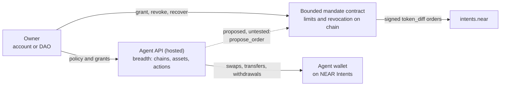

# Comparisons

Back to the [README](../README.md).

The comparisons validate the mandate's mechanism under one threat model. They do not show that the mandate is better than these products overall, and several of them are broader.

## Matched baseline (T5)

We applied the same threat model to our own re-implementation of the [Claw Guard](https://github.com/metafrogmeme-droid/claw-guard-near) design (pinned 225d37d), adapted to the same USDC/wNEAR `token_diff` authority on the pinned Intents verifier. Results describe that re-implementation in a local sandbox, not the deployed Claw Guard product; the adaptations are recorded with the results.

Executed in sandbox:

- its own revocation (pause and remove the agent) leaves withheld signed orders executable;
- removing the key on Intents stops them, but a regrant re-registers the same fixed-path key and revives them;
- a signature disclosed while the signer callback fails is released from accounting, so executed volume exceeded its daily cap.

Over-cap, injected-withdrawal and owner-recovery cases are blocked by both designs. The evidence page claims an increment only from a certified run in which the matching mandate gate passed.

## Compared with simpler alternatives (COMPARE)

When an owner stops trusting an agent, signed orders may still be outstanding. The mandate's answer is to remove the grant's key from `intents.near`. Simpler answers exist, and the verifier supports them: stop issuing and let orders expire, or cancel each order's nonce by signing an empty intent with the same key ([near/intents at 16d04f6](https://github.com/near/intents/blob/16d04f6ec4401263f8914638710260da50bb46b0/contracts/defuse/core/src/intents/mod.rs#L30-L37)). [contract/tests/compare_revocation.rs](../contract/tests/compare_revocation.rs) runs them side by side on the pinned verifier WASM.

- **Same setup for each strategy:** an account holding the same deposits, and three unexpired withheld orders of 1 USDC each, relayed by an unrelated account.
- **The owner-side ledger deliberately omits the third order.** One cancellation case uses only the ledger. The complete-list control also supplies the missing nonce. The mandate itself records each order on chain before requesting a signature, so a leaked signature or failed callback leaves the order in contract accounting. In the table, "unrecorded" means missing from the external ledger.
- **The account's key is a labelled test key**, standing in for the MPC-derived key.

| Owner's response | Signatures by the account key | Withheld orders that still execute before their deadlines | Unrecorded order stopped before its deadline | To resume trading |
| --- | ---: | ---: | --- | --- |
| Stop issuing, wait for expiry | 0 | 3 of 3 | no, until its deadline passes | nothing |
| Cancel recorded nonces (empty signed intents) | 2, one per recorded order | 1 of 3 (the unrecorded one) | no | same key |
| Cancel a complete nonce list (including the missing nonce) | 3, one per order | 0 of 3 | yes | same key |
| **Remove the key, resume with a fresh key (the mandate)** | **0 by the account key; the owner still signs `revoke`** | **0 of 3** | **yes** | **a new key; the mandate derives one per grant** |
| Remove the key, re-add the same key | 0 by the account key | 0 of 3 while removed, 3 of 3 after the re-add | yes while removed, no after the re-add | same key, which revives every unexpired order |

What this shows, and what it does not:

- **Cancelling every order needs the account's signer and a complete list.** With both, cancellation stops every listed order. The verifier batches the signed empty intents in one transaction. In the mandate the signer is the MPC network, which is the dependency an owner may most want to stop trusting. Removing the key needs neither the nonce list nor a signature from the grant's MPC key. The owner authorizes `revoke` and the contract removes the key and confirms removal in a callback, which T1 tests.
- **Effective cancellation is venue-specific.** The cancellation tested here names each order's nonce, so it needs the list. Some venues can invalidate earlier signatures without one: on Seaport, for example, the offerer increments its counter on chain, which invalidates every order it signed before, including ones it did not track ([Seaport documentation](https://github.com/ProjectOpenSea/seaport/blob/7f966fe7bd75932beb0366f6485aa720512b1259/docs/SeaportDocumentation.md)). This experiment covers the pinned Intents verifier only.
- **Waiting protects only once each order's deadline passes.** Removal protects once it is confirmed. The gap between the two is what revocation adds over waiting, and only the mainnet run gives a meaningful value. The runner records it as `revocation_window`: the lifetime left after confirmed removal (a lower bound), the time from the MPC sign request to the signature, and the time from signing to the deadline. With the demo's 60 s and the proposed mainnet 120 s order lifetimes, the gap may be small. What the experiment validates is the mandate's choice of revocation mechanism, not a capability unique to it. Other products could also remove and rotate keys, and expiry or nonce cancellation can coexist with trading limits. The mandate's value is the complete, tested combination:
  - limits checked before every signature;
  - accounting of signed and disclosed orders (T2, T2b);
  - revocation by key removal, and a regrant on a fresh key (T1);
  - recovery without the agent, oracle or MPC (T4).
- **Not tested here:** a relay that lands before the owner's action is final, and mainnet latency. This is a verifier-level experiment; the mandate's own gates are T1 to T4.

## Comparison with related NEAR projects

What this repository demonstrates together, in the sandbox gates certified for revision 51d2532 [1]:

1. **Bounded trading.** The agent only proposes; before signing, the contract enforces per-order, outstanding and turnover caps, a price bound against the oracle and a loss breaker (T2, T3, BOUNDARY).
2. **Grant-wide invalidation.** Once removal of the grant's key on `intents.near` is confirmed, every outstanding signed order of that grant fails, including orders someone withheld (T1).
3. **Fresh authority after regrant.** Each grant signs with a key on a new derivation path, so a regrant does not revive earlier orders (T1).
4. **Conservative accounting.** A reservation is released only on verifier evidence; a signature that was disclosed while the signing callback failed stays reserved (T2b).
5. **Owner recovery.** `recover` moves both assets to the owner's Intents account without the agent, oracle or MPC (T4).

None of it has run on mainnet yet.

**Veto** documents user-owned vaults with multiple agents, an Agent API integration and an interactive hosted sandbox at revision `a5b1f87`. Its published payment-screen benchmark records 50 of 50 synthetic attacks vetoed and 8 of 50 ordinary requests blocked. That benchmark measures a different payment workflow and threat set. The detailed table below draws on a source inspection at the earlier `a784344` pin. [Pinned Veto README](https://github.com/0xdopewilly/veto/tree/a5b1f87ab88dbb6c71c8b0b8ace39789f8140d73), [Veto benchmark methods](https://github.com/0xdopewilly/veto/tree/a5b1f87ab88dbb6c71c8b0b8ace39789f8140d73/bench), [Veto benchmark results](https://veto-beta.vercel.app/bench/results.json)

**Safe with Zodiac Roles** offers mature onchain delegation with scoped targets, functions, parameters and allowances. That addresses authority over calls made through the modifier. Previously issued off-chain orders depend on the venue’s own validation and invalidation rules. Our matched experiment compares those choices on NEAR Intents. [Zodiac Roles Modifier](https://docs.zodiac.eco/developers/roles)

**The official NEAR Intents Agent API** [2, 9] is the closest settlement integration, and it is much broader. One owner-signed policy covers actions, assets, per-asset limits, a USD budget, destinations, a timelock, a schedule, owner approval and a freeze, for swaps, transfers and withdrawals to many chains. It is a hosted service in an attested Intel TDX VM with a signed transparency log for every execution; its source is not public yet, so the running images can be checked but not rebuilt. A partner backend acts with a grant token, a bearer credential the owner signs for. Its routes differ in what the backend gets back, so they are compared separately:

- **Hosted actions** (`POST /v1/agents/{agent_id}/swap`, `transfer`, `withdraw`, `shield`, `unshield`): the API and the agent's wallet execute the action; the backend receives a status, not a signed order. Revoking a grant or changing the policy refuses every action that has not reached its dispatch commitment, and a freeze refuses every action; actions past the dispatch commitment cannot be recalled. There is no signed Intents order for the backend to hold back, and the documentation does not describe these routes as returning a signature [2].
- **Native signing routes** (off until the owner switches each on in the policy's `native` block): the API signs with the agent's own NEAR, EVM or Solana key and returns the signature to the backend once, without broadcasting it: NEP-413 messages for listed relying parties, EVM and Solana messages and transactions, EVM typed data. The policy's destinations, budget, timelock, schedule and approval do not apply to them. A NEP-413 signature already issued stays valid for its relying party until that party expires the nonce. The NEAR key can never sign for or call `intents.near` [2, 9].
- **`evm/sign-intent` and `solana/sign-intent`** (off unless the owner sets `evm.sign_intent` or `solana.sign_intent`) [9]: the EVM or Solana key signs a NEAR Intents payload (`transfer` intents only, `signer_id` = that key's own Intents account) and the route returns it to the caller, who publishes it (1Click, `intents.near` or a solver relay). The policy's destinations, assets, limits, budget, timelock, schedule and owner approval do not apply; the owner's own `sign_intent` rules do (receivers, 1Click deposits, withdrawal addresses, slippage). Anyone holding a signed payload can publish it until its deadline: up to 96 hours for one that pays only 1Click deposits, otherwise 300 seconds. The examples README says: "Freezing the account refuses new payloads but cannot recall one already signed." These routes are documented in the examples repository at commit `2552895`, read 2026-11-06; the hosted Native Accounts page we read the same day did not list them.

This is documentation evidence, not a tested weakness. We have not called the Agent API; the examples README itself states this behaviour and advises listing only the owner's own withdrawal addresses and signing payloads that are due soon. Ordinary hosted execution is not described this way.

This project makes a narrower trade-off: one NEAR contract enforces the limits and signs every Intents order, revocation is a key removal on `intents.near` that, once confirmed, voids the grant's outstanding signed orders and that anyone can check with a view call, and the owner's recovery is a contract call that involves no agent, oracle, MPC or API. It covers one asset pair.

How to read the table. Each project was read at the pinned commit or on the dated documentation listed under Sources; later versions may differ. The projects solve different problems, and several are broader than this one; the table compares only how they handle delegated authority. Each cell names its basis: **D** documented in the project's README or docs, **S** read in its source at the pinned commit, **E** executed by us. "Not documented" means we found no statement, not that the feature is missing.

| Project | Where limits are enforced | What revocation invalidates | After regrant | Uncertain or disclosed signatures | Recovery: destination and dependencies | Public reproducibility |
| --- | --- | --- | --- | --- | --- | --- |
| **Bounded mandate** (this repository) [1]. Agent trading of USDC/wNEAR from a contract-owned Intents account. Sandbox only so far. | In the mandate contract, before it signs: caps, oracle price bound, loss breaker. E | New proposals at once. After confirmed removal of the grant's key on `intents.near`: every outstanding signed order of the grant, withheld ones included. E | A new key on a new path (`mandate/v1/<epoch>`); earlier orders stay invalid. E | Released only on verifier evidence; a signature disclosed while its callback failed stays reserved. E | Owner `recover`: `mt_transfer` to the owner's Intents account, with no agent, oracle or MPC; needs NEAR, `intents.near` and the token contracts. E | Gate tests and certified evidence in this repository; the DEPLOY gate deploys a pinned reproducible build of the contract. E |
| **NEAR Intents Agent API** (official, hosted) [2, 9]. Agent wallets on NEAR Intents under an owner-signed policy: swaps, transfers, withdrawals, confidential balances; optional native signing with the agent's own keys. | Hosted actions, two layers: the API (destinations, USD budget, timelock, schedule; it also counts per-asset limits and the action rate) and the agent's wallet provider (actions, assets, limits, rate, owner approval, freeze). Native routes: only the owner's per-method switch, with the grant, freeze and, for NEAR transfers and calls, assets and limits; `evm/sign-intent` and `solana/sign-intent` add the owner's own `sign_intent` rules [9]. D | Hosted actions: `grant_revoke` or a policy change refuses actions that have not reached their dispatch commitment; queued ones fail with `authorization_stale`. A freeze, an on-chain wallet request, refuses every action. Dispatched actions cannot be recalled. Revoking a grant is an owner-signed message checked by the API, not a chain transaction. Native routes: revocation stops new requests; a NEP-413 signature already returned stays valid for its relying party until the nonce expires. `evm/sign-intent` and `solana/sign-intent`: a signed Intents payload already returned can be published by whoever holds it until its deadline, and a freeze cannot recall it [9]. Recall of other returned EVM or Solana signatures: not documented. D | A new grant needs a new token; a reused one is refused. All grants share one policy and one budget. D | Hosted actions: an `UNCERTAIN` action keeps its budget charge and limit count until its outcome is known; the charge is released only when the provider provably refused or never ran the action. Native signatures are returned at once and recorded in the agent's history, without the signature itself [9]. D | Funds stay in the agent's wallet on NEAR Intents. Documented exits are `withdraw` and `transfer` actions under a grant, to policy destinations. An owner exit that does not use the API: not documented. D | Attested VM with published compose and image digests, and per-execution transparency proofs. Source not public yet: images can be checked, not rebuilt. D |
| [Veto](https://github.com/0xdopewilly/veto) @a784344 [3]. Payment vault in which an AI screen in a TEE can only veto. Pays on NEAR, on Base through Chain Signatures, from OutLayer wallets and from an Agent API wallet whose grant Veto holds. Testnet; the Agent API path on mainnet. | Vault contract: per-payment and weekly caps, and an enclave-signed verdict checked on-chain. Agent API path: the owner's API policy, with Veto screening before it uses the grant. D, S | `freeze` stops new payments and cancels pending overrides; it does not change EVM payouts the MPC already signed. How such a payout is stopped afterwards: not documented. The owner can also deactivate or remove a single agent (`set_agent_active`, `remove_agent`). Agent API path: Veto holds the wallet's only grant, so the owner's Agent API controls apply. S, D | Not documented. | Spend is recorded before the MPC request and released if the MPC call returns a failure. A signature disclosed while the callback fails: not documented. S | `withdraw_to_owner` at any time, only to the owner; needs the token contract. S | Public source and tests; a script compares a local build with the code hash deployed on testnet. D |
| [Allowance](https://github.com/soldanoandrea/allowance) @74edffe [4]. Payment vault in which each agent is a function-call key on the vault account. No NEAR Intents in this version; the testnet run is prepared, not run. | The protocol (method-scoped key, no deposits) and the vault contract on every `pay`. D | `kill` pauses, denies queued approvals and deletes every agent key, so the next transaction signed with one is rejected by the protocol. `remove_agent` does the same for one key. D, S | Not applicable in the same form: an agent signs its own NEAR transactions with its function-call key rather than holding standing signed orders. `add_agent` registers a key the owner supplies. S | Not documented. | Owner `withdraw` / `withdraw_ft`, to the owner or a named account. S | Public source, CI, unit tests and a sandbox end-to-end test. The hackathon build is not reproducible; a NEP-330 descriptor is kept. D, S |
| [Agent Treasury](https://github.com/iskander-kudashev-13/agent-treasury) @46116b1 [5]. USDC vault with per-agent mandates for payroll and cross-chain payouts via 1Click, plus an optional Hyperliquid spot trading agent. Mainnet vault with real payouts and a mainnet trading session. | Payments: in the vault contract. Trading rules: in the off-chain worker, as owner-signed rule sets. D, S | `pause_agent` and `revoke_agent` stop vault payments. The trading kill switch halts bots; open positions stay, and the full stop is revoking the API wallet on Hyperliquid. D, S | Vault: `revoke_agent` is terminal and a new agent is needed. Hyperliquid API wallet: not documented. S | Not documented. | Owner `withdraw` from the vault, which pause does not block. Funds already sent to Hyperliquid return manually. D, S | Public source and contract tests; the mainnet vault is a reproducible build. D |
| [NEAR Private OTC](https://github.com/Watchmeecryt/near-private-otc) @55d5b64 [6]. Private OTC deal board: sealed terms in an OutLayer TEE, atomic settlement through `execute_intents`. Hosted app on testnet. | No delegated trading limit. The enclave checks that the two intents mirror each other; for an agent, the limit is its account balance. D | Per deal: the maker burns the nonces of its live offers, so those signatures can never settle. D, S | No grant: each party signs with its own key. D | Not documented. | Assets stay in each user's own verifier balance; the user withdraws with a self-signed `ft_withdraw`. D, S | Public source; the verifier's code hash and the enclave's WASM hash are published. A test suite: not documented. D |
| [Near-LEASH](https://github.com/soze-ki/Near-LEASH) @b122410 [7]. Policy gate for agent spending: EVM transactions through Chain Signatures and funding of 1Click swaps. Testnet, with a live MPC-signed Base Sepolia payment. | In the contract: allowlists, caps, cooldown and on-chain 1Click quote verification. D, S | `pause` and `remove_agent_key` stop new requests. An EVM transaction that was already signed stays valid, subject to its EVM nonce. D, S | `add_agent_key` adds a NEAR key, which signs requests rather than standing orders. Already-signed EVM transactions are governed by their EVM nonce (see the previous column). S | Design spec: a failed or timed-out MPC callback refunds the window debit. D | Owner `withdraw` of NEAR or NEP-141 tokens. S | Public source with unit and sandbox tests; the Intents path has not run on mainnet. D |
| Claw Guard design, our adaptation (T5) [8]. Our re-implementation of the [Claw Guard](https://github.com/metafrogmeme-droid/claw-guard-near) authority model, adapted to Intents `token_diff`; not their deployed product. | In the guard contract: per-order and daily caps. E | Pause or remove-agent: new proposals only; a withheld order executed. Removing the key on Intents stopped it. E | The same fixed-path key is re-registered, and a second withheld order that the key removal had blocked then executed. E | A signature disclosed while the signer callback failed was released, and executed volume exceeded the daily cap. E | Assets stay in the owner's own Intents account; the strand case was blocked. E | Claw Guard: CI reproducible build and a mainnet deployment (D). Our adaptation: [baseline/claw-guard-adapted](../baseline/claw-guard-adapted) and the T5 evidence (E). |

Sources:
1. This repository; gates executed at source revision `51d2532`: [`propose_order`](../contract/src/lib.rs#L419), [`revoke`](../contract/src/lib.rs#L325), [`recover`](../contract/src/lib.rs#L384), [per-grant path](../contract/src/state.rs#L54); certified [acceptance](../evidence/51d2532/acceptance.json), [T1 withheld/regrant](../evidence/51d2532/tests/T1.withheld-regrant.json), [T2 interleavings](../evidence/51d2532/tests/T2.sandbox-interleavings.json), [T2b](../evidence/51d2532/tests/T2b.callback-failed-after-disclosure.json), [T3 concession](../evidence/51d2532/tests/T3.concession.json), [T3 breaker](../evidence/51d2532/tests/T3.breaker.json), [BOUNDARY](../evidence/51d2532/tests/BOUNDARY.contract.json), [T4](../evidence/51d2532/tests/T4.dependency-failure.json), [DEPLOY](../evidence/51d2532/tests/DEPLOY.candidate.json).
2. NEAR Intents Agent API documentation, read 2026-11-05 and reread 2026-11-06 (the native routes were added to the comparison then; the hosted action routes and dispatch commitment rechecked that day): [How it works](https://docs.agentsonintents.com/integration/agent-api/concepts) (pieces, two enforcement layers, owner powers, which owner requests are written on chain), [Policies & Limits](https://docs.agentsonintents.com/integration/agent-api/policies-and-limits) (policy fields, which layer enforces what, freeze, policy change and `authorization_stale`, budget charge release, native rules), [Grants](https://docs.agentsonintents.com/integration/agent-api/grants) (bearer token, revocation, committed actions, token reuse), [Executions](https://docs.agentsonintents.com/integration/agent-api/executions) (dispatch commitment, timelock queue, the `recover` endpoint for undispatched uncertain actions), [Native Accounts](https://docs.agentsonintents.com/integration/agent-api/native-accounts) (native routes, what applies to them, issued NEP-413 signatures stay valid until the nonce expires, `intents.near` never signed for or called), [Status & Errors](https://docs.agentsonintents.com/integration/agent-api/status-and-errors) (`UNCERTAIN`, charge release), [Signing Standards](https://docs.agentsonintents.com/integration/agent-api/signing-standards) (grant revocation is an off-chain consent message; freeze is an on-chain wallet request), [Owner Signing](https://docs.agentsonintents.com/integration/agent-api/owner-signing) (withdraw before delete), [TEE & Attestation](https://docs.agentsonintents.com/integration/agent-api/tee) (TDX VM, funds outside it, source not public yet), [Transparency](https://docs.agentsonintents.com/integration/agent-api/transparency) (per-execution proofs).
3. Veto at `a7843443e94fb6c98f42f9139c57e0a0deb3129e`: [README L3-L22](https://github.com/0xdopewilly/veto/blob/a7843443e94fb6c98f42f9139c57e0a0deb3129e/README.md#L3-L22), [tests and deployed-code check L28-L54](https://github.com/0xdopewilly/veto/blob/a7843443e94fb6c98f42f9139c57e0a0deb3129e/README.md#L28-L54), [Agent API path L175-L179](https://github.com/0xdopewilly/veto/blob/a7843443e94fb6c98f42f9139c57e0a0deb3129e/README.md#L175-L179), [status L193](https://github.com/0xdopewilly/veto/blob/a7843443e94fb6c98f42f9139c57e0a0deb3129e/README.md#L193), [`freeze`](https://github.com/0xdopewilly/veto/blob/a7843443e94fb6c98f42f9139c57e0a0deb3129e/contract/src/lib.rs#L685-L698), [`withdraw_to_owner`](https://github.com/0xdopewilly/veto/blob/a7843443e94fb6c98f42f9139c57e0a0deb3129e/contract/src/lib.rs#L869-L880), [`on_evm_signed`](https://github.com/0xdopewilly/veto/blob/a7843443e94fb6c98f42f9139c57e0a0deb3129e/contract/src/lib.rs#L904-L933), [`execute_evm`](https://github.com/0xdopewilly/veto/blob/a7843443e94fb6c98f42f9139c57e0a0deb3129e/contract/src/lib.rs#L1159-L1197).
4. Allowance at `74edffec98cbeffd88d31223802f088c2d0f10b8`: [README L3-L23](https://github.com/soldanoandrea/allowance/blob/74edffec98cbeffd88d31223802f088c2d0f10b8/README.md#L3-L23), [not in this version L511-L513](https://github.com/soldanoandrea/allowance/blob/74edffec98cbeffd88d31223802f088c2d0f10b8/README.md#L511-L513), [testnet L561](https://github.com/soldanoandrea/allowance/blob/74edffec98cbeffd88d31223802f088c2d0f10b8/README.md#L561), [tests L569](https://github.com/soldanoandrea/allowance/blob/74edffec98cbeffd88d31223802f088c2d0f10b8/README.md#L569), [`withdraw`](https://github.com/soldanoandrea/allowance/blob/74edffec98cbeffd88d31223802f088c2d0f10b8/src/lib.rs#L232-L269), [`withdraw_ft`](https://github.com/soldanoandrea/allowance/blob/74edffec98cbeffd88d31223802f088c2d0f10b8/src/lib.rs#L372-L419), [`add_agent`](https://github.com/soldanoandrea/allowance/blob/74edffec98cbeffd88d31223802f088c2d0f10b8/src/lib.rs#L467-L507), [`remove_agent`](https://github.com/soldanoandrea/allowance/blob/74edffec98cbeffd88d31223802f088c2d0f10b8/src/lib.rs#L569-L585), [`kill`](https://github.com/soldanoandrea/allowance/blob/74edffec98cbeffd88d31223802f088c2d0f10b8/src/lib.rs#L657-L684), [build descriptor](https://github.com/soldanoandrea/allowance/blob/74edffec98cbeffd88d31223802f088c2d0f10b8/Cargo.toml#L20-L31).
5. Agent Treasury at `46116b1c88fc5d5068698dc73de348e62f428136`: [README L1-L9](https://github.com/iskander-kudashev-13/agent-treasury/blob/46116b1c88fc5d5068698dc73de348e62f428136/README.md#L1-L9), [reproducible mainnet vault L27](https://github.com/iskander-kudashev-13/agent-treasury/blob/46116b1c88fc5d5068698dc73de348e62f428136/README.md#L27), [limitations L72-L77, L84-L87, L92-L94, L98](https://github.com/iskander-kudashev-13/agent-treasury/blob/46116b1c88fc5d5068698dc73de348e62f428136/README.md#L72-L98), [contract tests L150](https://github.com/iskander-kudashev-13/agent-treasury/blob/46116b1c88fc5d5068698dc73de348e62f428136/README.md#L150), [API wallet L339-L341](https://github.com/iskander-kudashev-13/agent-treasury/blob/46116b1c88fc5d5068698dc73de348e62f428136/README.md#L339-L341), [mainnet demo L454-L470](https://github.com/iskander-kudashev-13/agent-treasury/blob/46116b1c88fc5d5068698dc73de348e62f428136/README.md#L454-L470), [`request_payment`](https://github.com/iskander-kudashev-13/agent-treasury/blob/46116b1c88fc5d5068698dc73de348e62f428136/contract/src/payment.rs#L51), [`pause_agent` / `resume_agent` / `revoke_agent`](https://github.com/iskander-kudashev-13/agent-treasury/blob/46116b1c88fc5d5068698dc73de348e62f428136/contract/src/agent.rs#L126-L156), [`withdraw`](https://github.com/iskander-kudashev-13/agent-treasury/blob/46116b1c88fc5d5068698dc73de348e62f428136/contract/src/owner.rs#L285-L287).
6. NEAR Private OTC at `55d5b645bc6212cf975474cee12f1a63e9a37d55`: [README L3](https://github.com/Watchmeecryt/near-private-otc/blob/55d5b645bc6212cf975474cee12f1a63e9a37d55/README.md#L3), [verifier hash L43](https://github.com/Watchmeecryt/near-private-otc/blob/55d5b645bc6212cf975474cee12f1a63e9a37d55/README.md#L43), [settlement L47](https://github.com/Watchmeecryt/near-private-otc/blob/55d5b645bc6212cf975474cee12f1a63e9a37d55/README.md#L47), [cancel L99](https://github.com/Watchmeecryt/near-private-otc/blob/55d5b645bc6212cf975474cee12f1a63e9a37d55/README.md#L99), [enclave hash L201](https://github.com/Watchmeecryt/near-private-otc/blob/55d5b645bc6212cf975474cee12f1a63e9a37d55/README.md#L201), [keeper cancel L323-L334](https://github.com/Watchmeecryt/near-private-otc/blob/55d5b645bc6212cf975474cee12f1a63e9a37d55/keeper/index.mjs#L323-L334), [keeper withdraw L335-L339](https://github.com/Watchmeecryt/near-private-otc/blob/55d5b645bc6212cf975474cee12f1a63e9a37d55/keeper/index.mjs#L335-L339), [agent limits AGENTS.md L89-L99](https://github.com/Watchmeecryt/near-private-otc/blob/55d5b645bc6212cf975474cee12f1a63e9a37d55/AGENTS.md#L89-L99).
7. Near-LEASH at `b122410aac152d8a38aa36ebe064baf42c91fc10`: [README L3-L16](https://github.com/soze-ki/Near-LEASH/blob/b122410aac152d8a38aa36ebe064baf42c91fc10/README.md#L3-L16), [tests L20-L23](https://github.com/soze-ki/Near-LEASH/blob/b122410aac152d8a38aa36ebe064baf42c91fc10/README.md#L20-L23), [paths L65-L78](https://github.com/soze-ki/Near-LEASH/blob/b122410aac152d8a38aa36ebe064baf42c91fc10/README.md#L65-L78), [`pause`](https://github.com/soze-ki/Near-LEASH/blob/b122410aac152d8a38aa36ebe064baf42c91fc10/contract/src/lib.rs#L366-L370), [`add_agent_key`](https://github.com/soze-ki/Near-LEASH/blob/b122410aac152d8a38aa36ebe064baf42c91fc10/contract/src/lib.rs#L381), [`remove_agent_key`](https://github.com/soze-ki/Near-LEASH/blob/b122410aac152d8a38aa36ebe064baf42c91fc10/contract/src/lib.rs#L409-L415), [`withdraw`](https://github.com/soze-ki/Near-LEASH/blob/b122410aac152d8a38aa36ebe064baf42c91fc10/contract/src/lib.rs#L476-L490), [signed EVM nonce, spec L182](https://github.com/soze-ki/Near-LEASH/blob/b122410aac152d8a38aa36ebe064baf42c91fc10/docs/guardrail-spec.md#L182), [MPC callback failure, spec L183](https://github.com/soze-ki/Near-LEASH/blob/b122410aac152d8a38aa36ebe064baf42c91fc10/docs/guardrail-spec.md#L183).
8. Claw Guard at `225d37d3c1b04959947fa7c18544fa50e273dcd8` (the design T5 re-implements; current [mainnet proof notes](https://github.com/metafrogmeme-droid/claw-guard-near/blob/ff5fdcb79741a6dc800f5e043d211497ad0ddf49/docs/PROOF_MAINNET.md) are a separate source): [issued signatures are not revoked by pause, THREAT_MODEL L233](https://github.com/metafrogmeme-droid/claw-guard-near/blob/225d37d3c1b04959947fa7c18544fa50e273dcd8/docs/THREAT_MODEL.md#L233), [DECISIONS L61](https://github.com/metafrogmeme-droid/claw-guard-near/blob/225d37d3c1b04959947fa7c18544fa50e273dcd8/docs/DECISIONS.md#L61), [reproducible mainnet build, README L71](https://github.com/metafrogmeme-droid/claw-guard-near/blob/225d37d3c1b04959947fa7c18544fa50e273dcd8/README.md#L71). Our adaptation: [fixed path](../baseline/claw-guard-adapted/src/lib.rs#L27), [`remove_agent` / `pause`](../baseline/claw-guard-adapted/src/lib.rs#L298-L310), [test](../baseline/claw-guard-adapted/tests/t5_baseline.rs), [certified result](../evidence/51d2532/tests/T5.baseline.json).
9. NEAR Intents Agent API examples repository ([NEAR-Intents-Agent-API/examples](https://github.com/NEAR-Intents-Agent-API/examples), linked from the Native Accounts page) at `25528957276e18ec933eb7d6e8e5c59a5fe033c4`, read 2026-11-06: `07-native-accounts/README.md`, [route table L40-L53](https://github.com/NEAR-Intents-Agent-API/examples/blob/25528957276e18ec933eb7d6e8e5c59a5fe033c4/07-native-accounts/README.md#L40-L53), [revoking a grant stops one caller L59](https://github.com/NEAR-Intents-Agent-API/examples/blob/25528957276e18ec933eb7d6e8e5c59a5fe033c4/07-native-accounts/README.md#L59), [signing returns the signature once and history keeps none L66-L68](https://github.com/NEAR-Intents-Agent-API/examples/blob/25528957276e18ec933eb7d6e8e5c59a5fe033c4/07-native-accounts/README.md#L66-L68), [signing NEAR Intents payloads, deadlines and the freeze L90-L116](https://github.com/NEAR-Intents-Agent-API/examples/blob/25528957276e18ec933eb7d6e8e5c59a5fe033c4/07-native-accounts/README.md#L90-L116), [the NEAR key never reaches the Intents contracts L128-L133](https://github.com/NEAR-Intents-Agent-API/examples/blob/25528957276e18ec933eb7d6e8e5c59a5fe033c4/07-native-accounts/README.md#L128-L133). Documentation only; nothing was executed against the Agent API.

### Complementary architecture

The two could fit together rather than compete. That is a design possibility, not a built or tested integration, and no user has asked for it yet. The Agent API is for breadth: many chains, assets and action types, hosted execution and per-execution transparency. Bounded mandate is for where trading limits and revocation must be verifiable on chain: the contract checks the limits before it signs, and revocation is a key removal that anyone can check with a view call. An Agent API agent proposing trades to a mandate is a proposed integration, not a built one. It stays untested until two things are tested: caller identity (which account the mandate sees calling `propose_order`; it accepts only its fixed agent account) and invocation compatibility (whether an Agent API route can make that exact call the mandate accepts).

