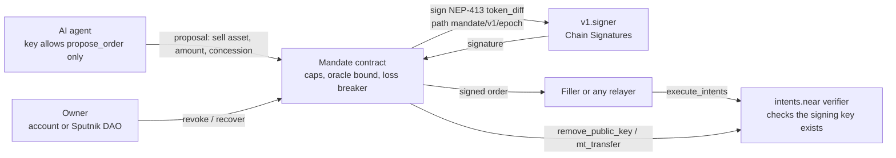

# Reviewer guide

Detail for checking the claims in the [README](../README.md): the owner journey, how it works, the evidence verifier and the quick demo, commands and timings, platform needs, ways to evaluate, the demo stages, status, gates, the attack log, the mechanism, known limits, review history and the repository layout. Comparisons are in [comparison.md](comparison.md); the opt-in live runner is in [live-runner.md](live-runner.md).

## What the owner does

Each step runs in `make demo`. The last column names the certified gate report that proves it, or the demo's own story check in `demo.json`, which is not an acceptance result.

| # | The owner | Demo stage | Proven by |
| --- | --- | --- | --- |
| 1 | Understands the mandate and its limits: assets, caps, price bound and loss breaker | Grant and limits; Console review | [demo.json](../evidence/173942f/demo.json) (`grant-active`, `console-review`); limits: [T3.concession](../evidence/173942f/tests/T3.concession.json), [T3.breaker](../evidence/173942f/tests/T3.breaker.json), [BOUNDARY.contract](../evidence/173942f/tests/BOUNDARY.contract.json) |
| 2 | Sees a useful permitted trade: the recorded model proposal, signed and filled within the limits | Bounded proposal and trade | Reaches `propose_order`: [MODEL.recorded-proposal](../evidence/173942f/tests/MODEL.recorded-proposal.json); signed and filled as signed: `model-proposal-on-chain`, `trade-executed` in [demo.json](../evidence/173942f/demo.json); every fill within the 0.5% concession: [T3.concession](../evidence/173942f/tests/T3.concession.json) |
| 3 | Sees a hostile request, clearly labelled as injected or scripted, refused at its boundary | Hostile requests | [BOUNDARY.attacks](../evidence/173942f/tests/BOUNDARY.attacks.json), [attack log](#attack-log) |
| 4 | Identifies the authentic withheld signed order: the verifier's simulation accepts that exact bundle | Withheld order | [demo.json](../evidence/173942f/demo.json) (`withheld-executable`); [T1.withheld-regrant](../evidence/173942f/tests/T1.withheld-regrant.json), which simulates both signed legs, rejects unmatched and underfunded controls, and reuses the exact bundle after removal and regrant |
| 5 | Revokes through the owner controls, after checking the exact preview | Revocation through the console | [CONSOLE.browser-sandbox](../evidence/173942f/tests/CONSOLE.browser-sandbox.json) (the test also requires the preview to equal the runner's intent; the report records the outcome) |
| 6 | Sees that same unexpired order rejected for the removed key, after confirmed key removal | Withheld relay rejected | [T1.withheld-regrant](../evidence/173942f/tests/T1.withheld-regrant.json) (every relay after removal must fail with the verifier's missing-key error for the mandate while the order is unexpired; the report records each error and the remaining lifetime); `withheld-rejected` in [demo.json](../evidence/173942f/demo.json) |
| 7 | Recovers the remaining assets to its Intents account without the agent, oracle or MPC | Recovery | [T4.dependency-failure](../evidence/173942f/tests/T4.dependency-failure.json) |
| 8 | Separately withdraws both assets from its Intents account to its own NEAR account, outside every recovery claim | Owner withdrawal | [WITHDRAW.both-assets](../evidence/173942f/tests/WITHDRAW.both-assets.json), [WITHDRAW.unregistered-owner](../evidence/173942f/tests/WITHDRAW.unregistered-owner.json) |

Between the revoke request and confirmed removal, orders already signed may still execute; step 6 happens after confirmation. In the demo the console's Revoke is signed by the labelled local sandbox test signer, not a wallet, and recovery and withdrawal are direct owner calls. The full stage list is under [What the demo runs](#what-the-demo-runs).

## How it works



1. The owner deposits USDC and wNEAR into the mandate's Intents account and grants trading with fixed limits. The contract derives a fresh Ed25519 key on path `mandate/v1/<epoch>` and registers it on `intents.near`.
2. The agent proposes a sell amount and a concession. The contract reserves exposure, reads both oracle prices and its balances, re-checks every limit, builds the exact order and has the MPC network sign it on the grant's path.
3. A filler counter-signs the other side and settles both through `execute_intents`.
4. `revoke` stops new authorization when it executes and removes the grant's key from `intents.near`. After the removal is confirmed, the verifier rejects every order signed with it; until then, already-signed orders may still execute.
5. `recover` transfers both balances to the owner's Intents account.

The product is the complete control system, not any one of its parts:

- **Delegation without a signing key.** The agent proposes trades; it never holds funds or a key that can sign orders or move assets. Its only NEAR key can call `propose_order` and nothing else.
- **Limits the agent cannot change.** Before signing, the contract checks per-order, outstanding and turnover caps, a price concession of at most 0.5% against the oracle, and a 2% loss breaker.
- **Revocation that covers signed orders.** Pausing an agent stops new orders, but orders it already signed stay valid until they expire or are cancelled, and how they can be cancelled depends on the venue (see [Compared with simpler alternatives](comparison.md#compared-with-simpler-alternatives-compare)). Here the owner's `revoke` removes the grant's signing key from NEAR Intents; once the removal is confirmed, every outstanding order of that grant fails, including one someone held back, and a later grant signs with a different key.
- **Recovery without dependencies.** `recover` moves both balances to the owner's Intents account with no agent, oracle or signing network involved. Withdrawing from there to the owner's NEAR account is the owner's own later step, outside the recovery claim.

## Why NEAR

- **A contract owns its Intents settlement account and signs for it.** The mandate contract is the account on `intents.near` that holds the treasury, and it gets every signature for that account from `v1.signer` through Chain Signatures, on its own derivation path `mandate/v1/<epoch>`. No single person or server holds the order-signing key; the MPC network's nodes hold only key shares. That describes mainnet `v1.signer`: in the sandbox evidence the signer is a single labelled test double, and our own signing on mainnet has not been exercised. Signing through the contract is what makes revocation a key removal: the contract calls `remove_public_key` on its own Intents account, and the verifier then refuses every order signed with that key. A regrant derives a key on a new path.
- **The NEAR Intents verifier** keeps each account's signing keys on chain (`add_public_key`, `remove_public_key`) and checks that the key exists when it executes a signed intent. Anyone can check the key with a view call.
- **Function-call access keys** restrict the agent's account at the protocol level: calls to other methods, deposits, transfers and key changes are refused before the contract runs (ten of the certified cases in the [attack log](#attack-log)).
- **Permissionless `execute_intents`** lets our filler, or anyone, settle the exact signed bundle; no hosted relayer is trusted.
- **Sputnik DAO** can be the owner, so grant, revoke, recovery and withdrawal become threshold-voted proposals (sandbox; certified at 173942f, see [Status](#status)).

## Running the demo and the gates

**Replay without setup.** Open the [committed evidence page](../evidence/173942f/page/index.html) in a browser. Open each step to inspect the recorded balances, grant key and receipts. The page runs offline and shows the certified comparison alongside the replay.

**Check the committed evidence (`make verify`, no toolchain)** and **run the story without Rust (`make quick`)**: see the two sections below.

**Run the full demo (`make demo`, needs Rust).** See a valid trade fill, hostile requests refused, the same unexpired signed order refused after revocation, and the owner recover and withdraw both assets.

```sh
git clone https://github.com/gryyny/bounded-mandate.git && cd bounded-mandate
make demo
open out/page/index.html out/console/index.html  # use xdg-open on Linux
```

The clone URL resolves once the repository is public; before that, use the checkout you were given. The product clone is self-contained and needs no funds or model key. `make demo` took about a minute with a warm build at the certified revision. First runs also download and build dependencies. [Platform needs](#platform-needs)

**Certify the full implementation.** On a clean clone check out `173942f768d928c0491f8ade0f2bc9882ba5aa85` and run `make test && make demo`. Open the generated page to see the acceptance result bound to the demo revision, spec, fixture and WASM hashes. If you already ran `make demo`, run `make test && make page` to refresh the saved demo page from the completed gates without executing the story again. [Expected outputs and timings](#commands-and-timings)

### Check the committed evidence (`make verify`)

`make verify` runs `node verify.mjs`. It needs Node 20 or later and no install, and is offline by default. It checks the bundle marked certified in [evidence/index.json](../evidence/index.json): every file against the bundle's `SHA256SUMS`, each required case from its own report, and this checkout's `SPEC.md`, fixtures and deployment candidate. It prints one line per check and ends `VERIFIED: …` or `NOT VERIFIED: …`, with a non-zero exit on any mismatch. Run it at a commit that contains the certified bundle.

The expected last line for the certified bundle is:

`VERIFIED: evidence/173942f (25 passed, 0 failed, 0 not verified, 1 skipped). Recorded evidence only; the tests were not rerun.`

The skipped check is the mainnet line, because no mainnet run is recorded. `node verify.mjs --mainnet` also reads a run's receipts from a public archival RPC; none exist yet, so it says so and exits 1. `node verify.mjs --help` lists the other flags.

What it does not establish:

- It checks recorded evidence and does not rerun the tests.
- `SHA256SUMS` is unsigned. The check detects accidental or partial change; it does not detect a bundle rewritten to be self-consistent.
- Trust in the bundle comes from the commit history and from rerunning `make test` yourself.

### Quick demo without Rust (`make quick`)

`make quick` runs the demo story on the exact deployment candidate with prebuilt test doubles. It needs Node 24 and network access for npm, the NEAR sandbox binary and Chromium, and no Rust. On Linux, install Chromium's system libraries first ([Platform needs](#platform-needs)).

- The test doubles are pinned in [fixtures/prebuilt](../fixtures/prebuilt/provenance.json) with provenance: built twice in the pinned cargo-near image with identical bytes. `make quick` checks their hashes and never rebuilds them.
- It writes only `out/quick/`, and its page and console are labelled prebuilt and uncertified. It certifies nothing; `make test` and `make demo` are the certified path.
- Expected last line: `setup … ms | story … ms | 60/60 assertions passed | browser start … ms (not in setup or story)`. The 60 are the 59 demo story checks and the prebuilt pin check.
- Measured at 173942f: on a clean GitHub Actions ubuntu-24.04 runner with no Rust toolchain, 82 s from job start (`npm ci`, Chromium with its system libraries, then `make quick` in 44 s: setup 15.3 s, story 20.4 s); 40 s warm on macOS arm64.

## Commands and timings

| Command | Expected last line | Measured at 173942f | What it proves |
| --- | --- | --- | --- |
| `make test` | A line starting `CERTIFIED: run`, followed by the run id and `out/evidence/acceptance.json`. A tree with uncommitted changes ends `COMPLETE BUT UNCERTIFIED (dirty tree)` instead. | macOS arm64 fresh clone (Node 24.22.1; no meta checkout, funds or model key): 1490 s with a cold build; run `20261110T112642713Z-78a406f01e1d` certified 37/37, with 198 Rust and 789 TypeScript tests passed. GitHub Actions ubuntu-24.04, [run 42806949311](https://github.com/gryyny/bounded-mandate/actions/runs/42806949311) (the link opens once the repository is public): 2257 s; run `20261110T112654590Z-a79b2ca819f0` certified. | All 37 required cases of the 17 gates passed in one run of a clean tree, bound to the revision and the spec, fixture and WASM hashes ([Required gates](#required-gates)). |
| `make demo` | `setup … ms \| story … ms \| 59/59 assertions passed \| browser start … ms (not in setup or story)` | macOS arm64: 59 s warm, run after `make test` (setup 15.8 s, demonstration 20.4 s, browser start 0.4 s; the rest is `npm ci` and the cached WASM build); a cold `make demo` was not measured separately. Linux CI: 72 s (setup 13.8 s, demonstration 20.3 s). | The nine-stage revocation story on a local sandbox ([What the demo runs](#what-the-demo-runs)). The 59 assertions are story checks, not acceptance results. |
| `make page` | A line starting `rendered` with the path to `out/page/index.html`. | Reads the saved `out/evidence/demo.json` and the latest local acceptance files. In the 173942f fresh clone it reproduced the page byte for byte. | Refreshes the evidence page after acceptance without running the sandbox again. The page explains any certification mismatch. |
| Open `out/page/index.html` and `out/console/index.html` | Both open from disk. The page makes no network request before you press its verification button; the console makes none before a button press, except to resume an action already pending in that browser. | Not timed. | The evidence page binds the demo to the acceptance run and shows gates as certified only after `make test` passed on the same clean revision, otherwise "not certified for this demo". The console is the static owner console with no backend: a read-only view, and exact previews of the owner's revoke, recover and withdrawal, signed outside the page. |

### What certified means

"Certified" is this project's own acceptance gate, not an external audit: every required case of every gate passed in one run of one clean revision, in a fresh clone and in CI.

`make test` records a run id, clears earlier results and ends with `tools/src/checks/acceptance.ts`. That step writes `out/evidence/acceptance.json` and fails unless every required case of every gate passed in this run, bound to the revision and the spec, fixture and WASM hashes. A run from a tree with uncommitted changes is never certified. Demo checks are story checks, not acceptance results.

## Platform needs

- Rust via rustup; the toolchain (1.97.1, with the `wasm32-unknown-unknown` target) is pinned in `rust-toolchain.toml` and installs on first use.
- `cargo-near` 0.22.0: `cargo install cargo-near --version 0.22.0 --locked`. On Linux install `libudev-dev` and `pkg-config` first.
- Node.js 24 and npm.
- Network access on the first run: crates, npm packages, the NEAR sandbox binary and Playwright's pinned headless Chromium, which both targets download once and reuse. No funds, model key or private repository access.
- On Linux, Chromium's system libraries once: `cd tools && npm ci --ignore-scripts && npx --no-install playwright install --with-deps chromium` (as in CI; installing system packages needs root). This applies to `make quick` as well as `make test` and `make demo`.

## Ways to evaluate

| Path | Do | See |
| --- | --- | --- |
| Video | Watch the short cut (85.9 s, six scenes: the problem, the agent trades, hostile requests refused and one order held back, owner revocation with the held order rejected, funds returned, where to verify); hosted once the site is published at [bounded-mandate-short.mp4](https://gryyny.github.io/bounded-mandate/video/bounded-mandate-short.mp4). A longer technical walkthrough (217.1 s) covers the same run, numbered by the same steps, plus the attack log, valid-trade results, matched alternatives, gates and provenance; hosted once the site is published at [bounded-mandate-demo.mp4](https://gryyny.github.io/bounded-mandate/video/bounded-mandate-demo.mp4). Both cuts were rendered from the 173942f fresh-clone demo ("Certified for this demo") ([video.json](../evidence/173942f/video.json); sha256 `e3de020d21336e1e51f781f4b007ac88bee653381b5e460bc7b6e5137b1366f6` short, `f0e35985501ef7bec78083cf89225046fd622211673ca25445f526ca47b1ae19` walkthrough). Both MP4s are in the bundle under [evidence/173942f/video/](../evidence/173942f/video); [tools/src/video/make.ts](../tools/src/video/make.ts) rebuilds them locally. | The revocation story from one sandbox run: balances, trading limits, a recorded model proposal traded, a signed order withheld, confirmed revocation, the withheld order rejected, balances recovered. |
| Evidence page | Open [evidence/173942f/page/index.html](../evidence/173942f/page/index.html) in a browser (self-contained, no network). Hosted copy, live once the site is published: <https://gryyny.github.io/bounded-mandate/> | The outcome against the agent's 50/50 objective, the withheld order's identity and its rejection, the regrant and disclosed-signature sandbox cases, acceptance gates, matched baseline, claims and non-claims, policy and provenance. An opt-in panel (§V) runs read-only checks against a mainnet RPC from the browser; nothing is requested before you press its button. `make demo` regenerates the page at `out/page/index.html`. |
| Owner console (sandbox; certified at 173942f, see [evidence/173942f](../evidence/173942f)) | After `make demo`, open `out/console/index.html`. Hosted copy, live once the site is published: <https://gryyny.github.io/bounded-mandate/console/> | A static console with no backend. Visitors get a read-only view of policy, grant status, key presence, orders, balances and evidence provenance. The owner's revoke, recover and withdrawal actions are previewed exactly and signed outside the page; the page holds no key or model credential and never resubmits on its own. External wallets connect through NEAR Connect (pinned library, in-page wallet list, adapters pinned by commit). Its browser flow is tested in headless Chromium against the sandbox only, through the labelled local test signer and the labelled sandbox test wallet; no real wallet provider has signed through it yet. |
| Mainnet receipts | Run the read-only commands in [Verify on mainnet](#verify-on-mainnet-read-only) with `curl` and `jq`; no wallet, key or funds | The pinned verifier WASM matches the code at `intents.near`. Live relay and recovery receipts are pending an approved run. |
| Attack log | Read the [attack log](#attack-log) | Each malicious request, the layer that stopped it, the enforcing source line and the certified result. |

### Verify on mainnet (read-only)

**Pending the approved mainnet run; no mainnet transaction has been executed.** The code-hash check works today. The second block is a template: its placeholders are filled in only after the run, and these commands send no transaction.

```sh
RPC=https://archival-rpc.mainnet.fastnear.com   # archival: receipts stay readable after the run

# Works today: code hash of intents.near ...
curl -sS "$RPC" -H 'Content-Type: application/json' \
  -d '{"jsonrpc":"2.0","id":1,"method":"query","params":{"request_type":"view_account","finality":"final","account_id":"intents.near"}}' \
  | jq -r .result.code_hash
# ... equals base58(sha256) of our verifier fixture (run in this repository)
python3 -c "import hashlib;n=int.from_bytes(hashlib.sha256(open('fixtures/verifier/defuse-0.4.5.wasm','rb').read()).digest(),'big');A='123456789ABCDEFGHJKLMNPQRSTUVWXYZabcdefghijkmnopqrstuvwxyz';s='';exec('while n:\n n,r=divmod(n,58)\n s=A[r]+s');print(s)"
```

Both print `BtA1BEFNS619KkvXFsgcpQ21Tb5yMm32aaUkn7xNothk`, as recorded in [fixtures/manifest.json](../fixtures/manifest.json) at block 222913804. A later upgrade of `intents.near` would change the live value.

```sh
# TEMPLATE until mainnet receipts exist. Placeholders: <...>.
MANDATE='<MANDATE_ACCOUNT>'; GRANT_KEY='<ed25519:GRANT_PUBLIC_KEY>'; NONCE='<WITHHELD_ORDER_NONCE_BASE64>'
view() {  # view <contract> <method> <json args>
  curl -sS "$RPC" -H 'Content-Type: application/json' \
    -d "{\"jsonrpc\":\"2.0\",\"id\":1,\"method\":\"query\",\"params\":{\"request_type\":\"call_function\",\"finality\":\"final\",\"account_id\":\"$1\",\"method_name\":\"$2\",\"args_base64\":\"$(printf %s "$3" | base64 | tr -d '\n')\"}}" \
    | jq -r '.result.result | implode'
}
view intents.near has_public_key "{\"account_id\":\"$MANDATE\",\"public_key\":\"$GRANT_KEY\"}"  # current state only: false now, not when it was removed
view intents.near is_nonce_used "{\"account_id\":\"$MANDATE\",\"nonce\":\"$NONCE\"}"           # current state only: the verifier can clean up expired nonces
view "$MANDATE" get_grant '{}'                                                               # grant epoch and state
curl -sS "$RPC" -H 'Content-Type: application/json' \
  -d '{"jsonrpc":"2.0","id":1,"method":"tx","params":{"tx_hash":"<TX_HASH>","sender_account_id":"<SENDER_ACCOUNT>","wait_until":"FINAL"}}' \
  | jq '.result.receipts_outcome[] | {executor: .outcome.executor_id, status: .outcome.status}'  # per-receipt outcomes
```

The two views above show current state only. The historical proof is the relay transaction's receipts: the verifier receipt fails with the removed-key error in a block before the order's deadline. `has_public_key` cannot say when a key was removed, and `is_nonce_used` can read `false` for a used nonce after the verifier's garbage collector cleans up expired nonces. The evidence page's opt-in panel checks the receipts this way.

## What the demo runs

Nine stages, in order, on a local sandbox with labelled test doubles and recorded model output. They follow the owner journey above (stages 1 and 2 are its first step); hostile requests run before the withheld order is signed, so the order keeps more of its lifetime for the relay:

1. **Grant and limits.** The owner grants; the contract registers the grant's derived key on the verifier, and the initial reference value matches the deposits at the posted prices.
2. **Console review.** The owner console, in headless Chromium, shows the grant status, limits, key presence, fixed accounts and balances exactly as the chain views read them.
3. **Bounded proposal and trade.** The recorded genuine model proposal reaches `propose_order` and is signed; the filler fills it on the pinned verifier and the reservation is released on settlement.
4. **Hostile requests.** Every case of the attack suite and the recorded response to an injected prompt is stopped at its boundary.
5. **Withheld order.** A second, scripted order is signed; the filler counter-signs a complete bundle, `simulate_intents` accepts it, and it is held back.
6. **Revocation through the console.** The owner checks the exact preview and presses Revoke; the transaction is signed by the local sandbox test signer, not a wallet. Removal of the grant's key is confirmed and the withheld order's reservation is released.
7. **Withheld relay rejected.** Another account relays the withheld bundle while it is still unexpired; the verifier rejects it for the removed key, before its deadline, with no balance change.
8. **Recovery.** With the agent stopped, the oracle failing and the MPC on hold, direct owner `recover` calls (not through the console) move both assets to the owner's Intents account.
9. **Owner withdrawal.** Direct owner `ft_withdraw` calls move both assets to the owner's NEAR account, registering wNEAR storage first because the demo starts the owner unregistered there. This is outside every recovery claim.

The 59 assertions are story checks, not acceptance results; their total is derived at run time.

## Status

| Area | State |
| --- | --- |
| Core mandate: bounded trading, grant-wide revocation, regrant, conservative accounting, recovery | **Certified in sandbox** at 173942f (earlier at 51d2532, 2373d39, 72bf8c7, 958d411, bc3fed6, 4fec11b, f5e34f9, 0e915a2, f01b496 and f60f999): every required case of every gate passed in one run of a clean tree, in an independent fresh clone and in CI. Our contract and the exact mainnet Intents verifier WASM execute; the MPC signer, oracle and tokens are labelled test doubles. |
| Model input | A genuine recorded `claude-haiku-5-5` interaction is replayed into `propose_order` (MODEL gate). No gate or demo calls a model. |
| Mainnet | **Pending approval.** The lead approves the exact setup record first and the hash of the runner manifest after verified setup. |
| Static owner console | Implemented; sandbox; certified at 173942f, see [evidence/173942f](../evidence/173942f). Tested in headless Chromium against the sandbox through the labelled local test signer, not a wallet: CONSOLE.browser-sandbox (revoke, recovery and withdrawal of both assets through the console, each imported and verified by the runner) and CONSOLE.access-controls (a wrong owner, network or deployment disables every control; a cancelled signature, a rejected transaction and a reload during a pending action resubmit nothing). External wallets: CONSOLE.wallet-sandbox runs the NEAR Connect path end to end with the labelled sandbox test wallet (picker, sandboxed adapter, a rejection in the wallet and a closed wallet window, both leaving the action pending until the owner forgets it, signing, the runner's import, a reload, a framed page, another account, adapter bytes checked against their pin, planted wallet lists and adapter caches ignored). The eight pinned real wallet adapters were fetched, all eight matched their recorded sha256 and answered under the console's CSP with no CSP violation, without an account and with nothing signed (`tools/src/console/wallets-check.ts --browser`; report in the evidence bundle's `console/wallet-adapter-check.json`, network-dependent and not part of `make test`); no real wallet provider has signed through the console yet. |
| Owner withdrawal of both assets from the owner's Intents account to its NEAR account (`ft_withdraw`) | Implemented; sandbox; certified at 173942f, see [evidence/173942f](../evidence/173942f). Runner-signed and imported external steps (WITHDRAW.both-assets, WITHDRAW.unregistered-owner, WITHDRAW.failed-receipt-retry). The owner's own action, outside the contract and outside every recovery claim. |
| Sputnik DAO as owner | Sandbox; certified at 173942f, see [evidence/173942f](../evidence/173942f). DAO.sputnik-owner passes in sandbox against the pinned mainnet factory code (sputnikdao2 2.3.1) with a council of three and 2-of-3 threshold voting: one approval executes nothing; two execute grant, revoke, recovery to the DAO's Intents account and the DAO's own withdrawal. In sandbox the DAO code is deployed onto the owner account rather than created by the `sputnik-dao.near` factory, and the DAO's token storage registration was tested only on the mock token, not on mainnet tokens. |
| Optional live agent with per-order and cumulative sale budgets | Sandbox; certified at 173942f, see [evidence/173942f](../evidence/173942f). The runner's remaining budgets are in the agent's snapshot, prompt and validation (AGENT.budget-bounds); the no-transaction rehearsal has run with stub providers only (AGENT.rehearsal), including before any grant on the planned policy and inventory at observed prices; LIVE.agent-template runs the primary template's whole sequence in sandbox with a synthetic provider answer. No live provider is qualified and no paid inference has run. |

Certified results are committed under [evidence/](../evidence/) and indexed by source revision in [evidence/index.json](../evidence/index.json). Each entry records:
- the acceptance verdict, with every required case of every gate bound to that revision and to the spec, fixture and WASM hashes;
- the environment, commands and exit results;
- an independent fresh-clone run without funds, model credentials or private-repository access.

Release checks at 173942f, in the bundle's [release/](../evidence/173942f/release) and [console/](../evidence/173942f/console) folders: the full-history secret scan of both repositories found 0 findings; the site check found 0 problems (2 pages, and 2 videos against the video manifest); the license check flagged no problem; the README link check found 0 problems; all 8 pinned wallet adapters matched their sha256 and answered with 0 CSP violations (no account, nothing signed).

`evidence/426914d` is an earlier bundle in the legacy report format, kept unchanged; current rules do not certify it. See [SPEC.md](../SPEC.md) for the requirements.

## Required gates

A gate passes only when every one of its required cases ([tools/src/evidence/required.ts](../tools/src/evidence/required.ts)) passed in one run of a clean revision. T1 to DEPLOY were first certified at f60f999; DAO to CONSOLE were added, and all required cases were first certified together at f01b496 (33 then). CONSOLE.wallet-sandbox was added at 4fec11b, where all 34 passed; COMPARE was added at 958d411, where all 35 passed; 72bf8c7 passed the same 35 with stricter T1 and COMPARE assertions. SIGNER.conformance and LIVE.open-challenge were added after 51d2532, so 37 cases of 17 gates are now required; the 51d2532 bundle predates them. All 37 were first certified together at 173942f.

- **T1**: a withheld signed order relayed after revocation, after regrant, during pending signing and activation, and after failed removal and retry.
- **T2**: seeded randomized interleavings, in unit tests and in sandbox, with no cap violation and no double release.
- **T2b**: a signature disclosed while the mandate's callback fails stays accounted for when relayed independently.
- **T3**: the 0.5% concession bound on every fill, feed and timing checks, and the loss breaker.
- **T4**: recovery with the agent, oracle and MPC unavailable, at the record bound and the open-order limit, and after registration reconciliation.
- **T5**: the matched baseline.
- **BOUNDARY**: the contract's own boundary cases and the attack suite.
- **MODEL**: a recorded genuine model proposal reaches `propose_order`.
- **DEPLOY**: the proposed deployment binary (reproducible-build fixture) exercised in sandbox.
- **DAO**: a pinned Sputnik DAO (mainnet factory code) as the fixed owner, threshold-voted, in sandbox.
- **AGENT**: the runner's sale budgets in the agent's snapshot, prompt and validation, and the no-transaction provider rehearsal with stub providers (on an observed grant, and on the planned grant before one exists).
- **HANDOFF**: external owner actions persisted as intents and imported by transaction hash; refusals of altered, unrelated and duplicate imports; lost-response resume; an unrecorded owner transaction stops the run.
- **WITHDRAW**: the owner's `ft_withdraw` of both assets after recovery, with an unregistered owner and a failed receipt retried, outside recovery claims.
- **LIVE**: the primary live-agent template's full sequence in sandbox on the exact deployment binary, with a synthetic provider answer; and the optional open challenge (LIVE.open-challenge): the open and close templates after a completed run, with an adversary holding the agent key, in sandbox.
- **CONSOLE**: the owner console in headless Chromium against sandbox through the labelled local test signer and, through NEAR Connect, the labelled sandbox test wallet; neither is a real wallet provider.
- **COMPARE**: the matched comparison of the owner's alternatives on the pinned verifier: wait for expiry, cancel recorded nonces, remove the key and resume with a fresh key, remove and re-add the same key.
- **SIGNER**: the contract's MPC response decoder and key check against a recorded mainnet `v1.signer` EdDSA response (read-only fixture; not our own signing on mainnet). The contract's `ext::verified_signature` is private, so the test composes the same public adapter calls (`mpc::parse_signature`, then the host `ed25519_verify` against `mpc::parse_public_key`); a check added only inside `verified_signature` would not be covered.

The owner-key rescue (RESCUE.owner-key) is reported separately and never counts toward a gate.

## Attack log

Every row is a request the certified attack suite ([tools/src/attacks/suite.ts](../tools/src/attacks/suite.ts)) or a revocation gate sent in the sandbox at 173942f. "Stopped by" is the layer that actually refused it, classified from the observed error, and each case checks that grant, orders, balances and keys were unchanged. The [attack gate](../evidence/173942f/tests/BOUNDARY.attacks.json) records 39 of 39 requests refused and contained across five layers: 10 local validations, 14 contract method checks, 4 policy checks, 10 agent key permission checks and 1 verifier check. The page labels the separate prompt-injection replay. The short cut's hostile-requests scene states all five layers with these counts (its caption in [video.json](../evidence/173942f/video.json)). The T1 and T2b reports below cover separate revocation cases.

| Attack | Cases | Stopped by | Enforcing source | Certified result |
| --- | --- | --- | --- | --- |
| Model output that adds a recipient, raw payload, MPC path, public key or raw token id, names a forbidden asset, a negative amount or an out-of-range concession, asks for a withdrawal, or is not JSON | 10 `adapter-*` | Adapter schema, before any transaction | Strict decision union [tools/src/agent/decision.ts#L7-L10](../tools/src/agent/decision.ts#L7-L10); proposal shape [tools/src/types.ts#L12-L18](../tools/src/types.ts#L12-L18); [`judge`](../tools/src/agent/decision.ts#L66-L71) | Rejected; nothing sent |
| The same requests sent straight to the chain with the agent's key, plus an amount of 2^128 | 7 `direct-*` | Contract input schema | `Proposal` with `deny_unknown_fields`, `Asset` enum and `U128` [contract/src/types.rs#L27-L38](../contract/src/types.rs#L27-L38) | Deserialization fails; state unchanged |
| Zero amount, amount 2^128-1, 400 USDC above the 20% per-order cap, 51 bps concession | 4 `direct-*` | Contract policy | [contract/src/lib.rs#L429-L430](../contract/src/lib.rs#L429-L430) (amount), [#L440-L443](../contract/src/lib.rs#L440-L443) (concession), [#L461](../contract/src/lib.rs#L461) and [#L903-L906](../contract/src/lib.rs#L903-L906) (per-order cap) | Panics with the named limit; state unchanged |
| Agent key calls `revoke`, `grant`, `recover`, `on_signed` or `settle_order`, attaches a deposit, calls `mt_transfer` or `add_public_key` on the verifier, sends NEAR, or adds a full-access key | 9 `agent-*` and `direct-deposit` | NEAR protocol: the agent's function-call key (receiver mandate, method `propose_order`, no deposit) | Enforced by nearcore before any contract runs. Our setup creates the key at [tools/src/demo/world.ts#L121-L125](../tools/src/demo/world.ts#L121-L125) via [tools/src/near/sandbox.ts#L59](../tools/src/near/sandbox.ts#L59); the live preflight refuses any other agent key ([tools/src/live/preflight.ts#L236-L247](../tools/src/live/preflight.ts#L236-L247)) | Transaction refused; not executed |
| Another account calls `propose_order`, `grant`, `revoke` or `recover` | 4 `attacker-*` | Contract role check | [contract/src/lib.rs#L420-L423](../contract/src/lib.rs#L420-L423) (agent only); [`assert_owner`](../contract/src/lib.rs#L927-L932), called first by [`grant`](../contract/src/lib.rs#L283-L284), [`revoke`](../contract/src/lib.rs#L325-L326) and [`recover`](../contract/src/lib.rs#L384-L385) | "only the agent may propose" / "only the owner"; state unchanged |
| Another account calls a callback (`on_signed`, `on_key_removed`, `on_recovery_transferred`) | 3 `attacker-callback-*` | Contract: `#[private]` callbacks | [`on_signed`](../contract/src/lib.rs#L727-L728), [`on_key_removed`](../contract/src/lib.rs#L656-L657), [`on_recovery_transferred`](../contract/src/lib.rs#L829-L830) | "Method ... is private"; state unchanged |
| A relayer submits a transfer-to-attacker intent claiming the mandate as signer, signed by an unregistered key | `forged-mandate-transfer` | NEAR Intents verifier (exact mainnet WASM [fixtures/verifier/defuse-0.4.5.wasm](../fixtures/verifier/defuse-0.4.5.wasm)) | Key check in the declared source, [near/intents@16d04f6 engine/mod.rs#L70-L73](https://github.com/near/intents/blob/16d04f6ec4401263f8914638710260da50bb46b0/contracts/defuse/core/src/engine/mod.rs#L70-L73) | "public key ... doesn't exist for account"; nothing moved |
| A signed order is withheld, the owner revokes, and another account relays it before its deadline; again after a regrant | T1 withheld-regrant | Verifier key check after confirmed removal; a new derivation path per grant | Revocation [contract/src/lib.rs#L325](../contract/src/lib.rs#L325), release on confirmed removal [#L1001-L1002](../contract/src/lib.rs#L1001-L1002), path `mandate/v1/<epoch>` [contract/src/state.rs#L54](../contract/src/state.rs#L54); verifier check as above | [Rejected; zero executions after confirmed removal, none revived after regrant](../evidence/173942f/tests/T1.withheld-regrant.json) |
| The MPC publishes a valid signature while the mandate's callback fails, and the order is relayed independently | T2b | Contract accounting: no release without trusted evidence | Release rules [contract/src/lib.rs#L53-L59](../contract/src/lib.rs#L53-L59); unknown signing outcome stays reserved [#L757-L759](../contract/src/lib.rs#L757-L759) | [Order stays reserved, settles on evidence and fails after removal](../evidence/173942f/tests/T2b.callback-failed-after-disclosure.json) |

The contract's own boundary cases (67 sandbox cases, all rejected at their boundary) are in [BOUNDARY.contract](../evidence/173942f/tests/BOUNDARY.contract.json). Permitted but poor trades are not attacks the mandate stops: they are bounded by the caps, the concession limit and the loss breaker (T3).

## Mechanism in detail

- **Agent.** A separate account whose only key is a function-call key for `propose_order` with a finite allowance. A proposal names only the asset to sell, the amount and a concession of at most 50 bps. It cannot name recipients, payloads, keys, paths or token IDs.
- **Contract.** It reserves exposure and charges turnover before any external call, reads both oracle prices and its verifier balances, re-checks every cap and the loss breaker, then builds an exact NEP-413 `token_diff` with a versioned nonce and a short deadline. It signs through its own MPC derivation path `mandate/v1/<epoch>`, which is never reused.
- **Accounting.** A reservation is released exactly once, and only on trusted evidence: the verifier reports the nonce used, block time passes the deadline, or removal of the covering key is confirmed. A signature published by the MPC whose callback failed stays reserved. Every proposal permanently charges at least `proposal_charge_bps` of turnover, so a grant accepts at most `turnover_cap / proposal_charge` proposals. The charge consumes authorization capacity; no tokens move and no fee is paid. It bounds order records per grant, not storage across grants (each regrant is an owner decision). At most 32 orders are open at once, so confirmed removal releases them all within one callback's fixed gas.
- **Revocation.** Key registration and removal are serialized. Revocation stops new authorization at once (`revoking`); confirmed removal (`revoked`) releases every reservation of that grant. Failed removal can be retried.
- **Unresolved registration.** If the key-registration callback fails, the owner calls `reconcile_registration`. It resolves only on observing the grant key registered on the verifier; absence or elapsed time never resolves it, because a pending registration could still land. If both the registration and its callback failed, an emergency rescue is needed: confirm from final receipt outcomes that nothing can still register, re-add the key with an owner-held key on the mandate account, then reconcile and revoke. That rescue is reported separately from ordinary recovery and is impossible for a deployment that leaves no full-access key on the mandate account.
- **Recovery.** With the grant revoked, the owner moves each asset's verifier balance to the owner's Intents account with `mt_transfer`. No price read, signature or agent action is involved. This is not a withdrawal to an external wallet; moving funds out of Intents is the owner's own later action.
- **Owner withdrawal (sandbox; certified at 173942f, see [evidence/173942f](../evidence/173942f)).** After recovery the owner, not the contract, withdraws each asset from its own Intents account to its NEAR account with `ft_withdraw` on the verifier, registering token storage only where needed. A failed withdrawal leaves the Intents balance intact and is retried without double counting. It is outside every recovery claim.
- **Filler.** Our own separately keyed account signs the matching side, pays the verifier fee, and submits both payloads through permissionless `execute_intents`. It never builds a replacement order after an ambiguous result.

Demo policy: per-order and outstanding caps 20% of the initial reference value, turnover cap 100%, concession at most 0.5%, oracle age at most 60 s, confidence at most 0.5%, loss breaker at 2% drawdown, deadline at most 60 s, and a per-proposal charge of 0.5%. These are demonstration settings, not proven production risk limits. With this policy, the measured storage requirement for a full grant (200 proposals of about 780 bytes each, plus grant state) is about 4.67 NEAR in total for the mandate account, including about 3.1 NEAR for the contract code.

## Known limits

- A transient price reading below the breaker threshold stops new authorization for the rest of that grant.
- A transaction's top-level result can arrive before its detached key-registration or removal receipts finish; tools poll `get_grant` until no key operation is in flight.
- Registration presence is evidence of our registration or of a verifier-admin key addition; verifier admins can already lock or alter the account, so this adds no new trust.
- Sandbox timing does not represent mainnet latency.
- The owner console's wallet path has been exercised through NEAR Connect with the labelled sandbox test wallet only. The pinned real wallet adapters load under the console's CSP, but no real wallet provider has connected an account or signed through the console yet. Meteor's adapter is younger than the 14-day age rule (its release branch keeps only one version); see `fixtures/wallets/near-connect.json`.

## Found and fixed

An independent review of this release found these problems before certification; each fix is in the certified revisions f01b496 through 958d411:
- **An owner transaction could be absorbed by a later runner-signed step, and owner keys not in the manifest were invisible.** The runner now requires each signing key's exact chain nonce before every send and import, and snapshots the owner's complete key set; any difference stops the run.
- **The demo claimed a console review and a console revocation without opening the console.** Both now run through the console in headless Chromium.
- **A loose match accepted a relay failure as the effect of revocation.** Only the verifier's exact removed-key error counts, at a rejection block before the order's deadline.
- **Unknown console reads.** They never confirm key removal and never enable withdrawal.
- **The local test signer** is bound to the deployment and the owner.

A second review, of the presentation and release changes, found these before f5e34f9 was certified:
- **The first-screen diagram overstated the guard comparison.** The withheld order revived by a regrant is a second one, which removing the key on Intents had blocked; the diagram and alt text now say so.
- **A video "site check" was claimed but never ran.** The site check now requests both planned video URLs and compares them with the certified cuts in `video.json`; `--video` requires the manifest.
- **Committed evidence recorded machine-local paths.** Gate reports now record repository-relative commands, and acceptance refuses a report that records an absolute path.
- **A T5 test race** (the signer's pending request read once, a block too early) failed one fresh-clone run at 3418307; the test now polls for it.
- **Fees of refused handoffs** are counted against the fee cap.
- **Unrecorded transactions.** A closing check looks for unrecorded owner, agent and filler transactions before a run reports completion.

A third review, after f5e34f9, found implementation gaps that the owner's approvals would have hit; all are fixed and re-reviewed in 4fec11b, certified again with the deposit fix below in bc3fed6 and with the comparison (COMPARE) in 958d411:
- **No external-wallet connector.** The console now connects the owner's wallet through NEAR Connect, with an in-page wallet list and each adapter checked against a pinned sha256 before it runs (CONSOLE.wallet-sandbox).
- **Provider qualification could not run before the first grant.** The rehearsal now decides on the planned grant, labelled as not on chain.
- **A rejected proposal could still "qualify" the provider.** Only an accepted proposal whose pre-signing checks pass, or a decline, qualifies; the verifier re-derives the claim.
- **The wallet check was planned at a step where Revoke is correctly disabled.** It is now a connection check before the run; the cancelled-signature check happens at the run's first recovery.
- **A closed wallet window counted as a cancellation.** A wallet's error now leaves the action pending until the owner forgets it.
- **Wallet lists and adapter code could be planted** through the shared origin's storage or NEAR Connect's cache. Storage is in memory, the cache holds nothing, and only pinned bytes run.
- **The rehearsal state was not bound to its manifest.** It is now.
- **A fresh clone at 98cc5fe failed the license check**, because NOTICE did not name the wallet fixture. NOTICE now names it and the inlined library.
- **The rehearsal fell back to the inventory ceiling (5 USDC + 1.25 wNEAR) instead of the planned deposit (5 USDC + 0.90 wNEAR).** At the approval package's prices the ceiling is balanced and the model is never called. The deposit is now required and checked against the ceiling, and a test runs the documented commands on the real template (bc3fed6).

A fifth round of independent review, of the owner-journey release (f427ac9 to 72bf8c7), found no blockers; these were fixed before 72bf8c7 was certified:
- **T1 counted any failed relay after removal as revocation.** It now requires the verifier's missing-key error for the mandate while the order is unexpired, records each error and the remaining lifetime, and adds a pre-removal simulation. That version checked the mandate leg only. The full-bundle proof is described below.
- **COMPARE did not check the filler's nonce** after a bundle rejected for a used order nonce; every relay now requires the filler nonce to be committed exactly when the bundle executed.
- **`expired_when_read` in the runner's revocation window was true at exact equality with the deadline**, where the verifier still accepts the order.
- **A step could show a success status without its recorded values, or call a scripted fallback proposal model output.** Both now read "not in this evidence" or "scripted proposal".
- **Unreadable token decimals could show raw units as whole tokens in the console.** They now show as raw units.
- **`prepare.ts` accepted any storage figure and an unbound report.** It now enforces the spec's per-grant record bound unless an explicit deviation is recorded, and binds its report to its inputs.

The follow-up at 2373d39 shows every enforcement layer in the short cut, keeps the walkthrough tables visible, and distinguishes the replay verdict from the order source across the demo, page, console and both cuts. The regression checks cover a replayed decline followed by a scripted proposal. The certified sandbox run uses a recorded proposal and passes its MODEL check. The earlier 72bf8c7 short cut omitted the verifier row and is archived with that presentation defect.

The competitive review at 51d2532 required both signed legs to simulate before revocation, then replayed both complete bundles unchanged after confirmed removal and regrant. The same bundle failed without filler funds, and the mandate leg alone returned an invariant violation. The demo and runner now also require the verifier to return both expected execution entries. The selected trade sample completed **15 of 15** fills with zero authorization refusals, distinct from the **39 of 39** hostile requests refused. The samples use scripted proposals and the pinned verifier in sandbox. See [T1](../evidence/51d2532/tests/T1.withheld-regrant.json), [legitimate trades](../evidence/51d2532/tests/T3.concession.json), [hostile requests](../evidence/51d2532/tests/BOUNDARY.attacks.json) and the [matched alternatives](../evidence/51d2532/tests/COMPARE.revocation-alternatives.json).

## Layout

| Path | Contents |
| --- | --- |
| [SPEC.md](../SPEC.md) | Pinned product specification; origin and hash in [spec-source.json](../spec-source.json). |
| `contract/` | Rust mandate contract; `contract/tests/` holds the sandbox and adversarial gate suites. |
| `stubs/` | Labelled test doubles for the MPC signer, oracle and tokens. |
| `baseline/` | Our re-implementation of the Claw Guard design, adapted for the matched comparison. |
| `tools/` | TypeScript model adapter, filler, attack suite, demo, live runner, evidence page, owner console and release checks (`tools/src/release/`: secret scan, site routing and CSP, licenses). |
| `fixtures/` | Pinned external inputs and recorded model interactions, with provenance in `fixtures/manifest.json`. |
| `evidence/` | Curated gate and demo evidence, bound to a source revision. |
| [hosting/](../hosting/) | Prepared GitHub Pages workflow and routing notes. The workflow is saved disabled and is enabled only at publication. |
